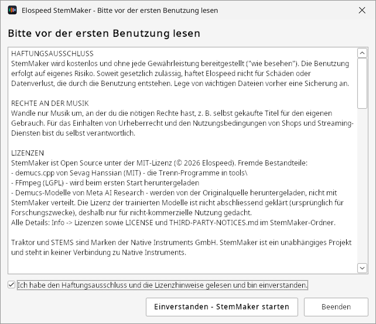
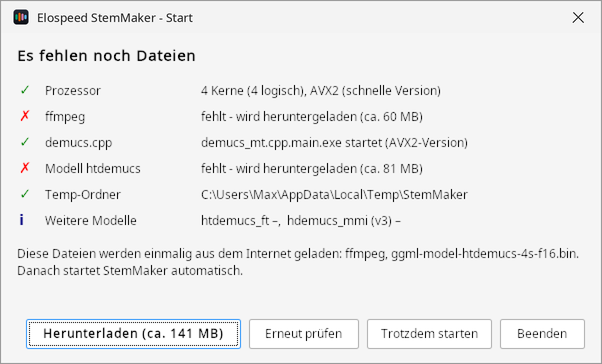
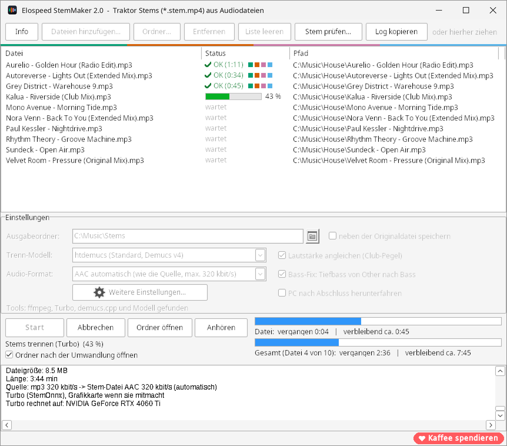
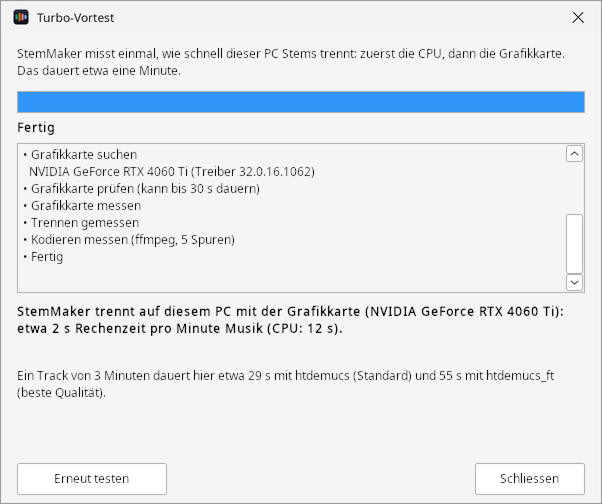
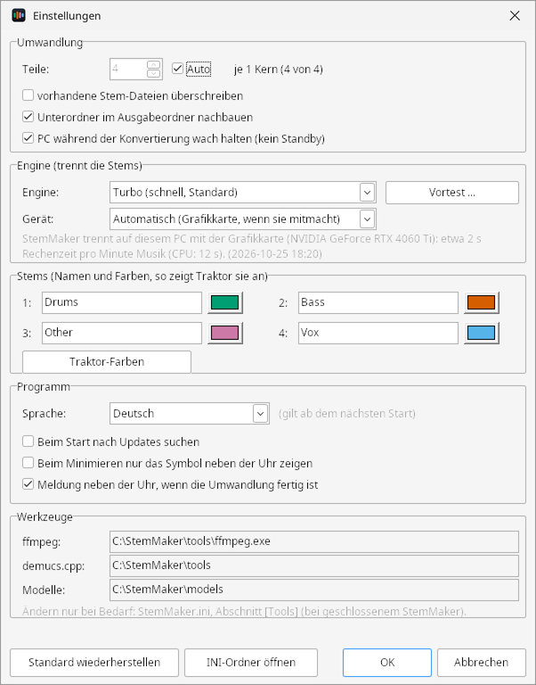
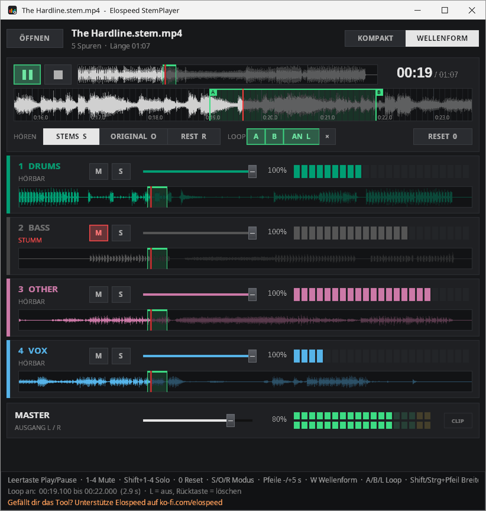
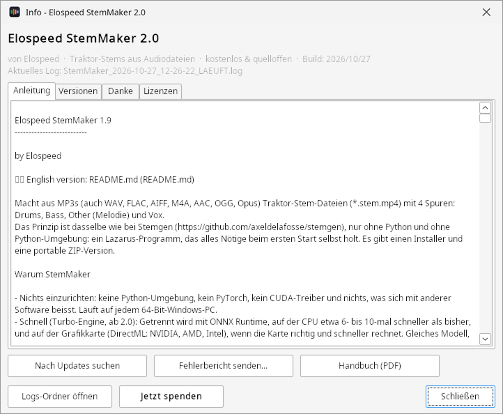

# Was StemMaker macht {#einleitung}

## Stems in zwei Sätzen

Ein **Stem** ist eine Spur, die nur einen Teil eines Songs enthält, zum Beispiel nur das Schlagzeug oder nur den Gesang. Eine **Stem-Datei** (`.stem.mp4`) packt den fertigen Song und vier solche Spuren in eine einzige Datei, sodass du beim Auflegen jede Spur einzeln leiser machen, stummschalten oder mit Effekten belegen kannst.

StemMaker macht aus deinen normalen Audiodateien (MP3, WAV, FLAC, AIFF, M4A, AAC, OGG, Opus) solche Stem-Dateien mit den vier Spuren:

::: stems
[Drums [Schlagzeug, Percussion]{.klein}]{.drums}
[Bass [Bass, Tiefbass]{.klein}]{.bass}
[Other [Melodie, Synths, Rest]{.klein}]{.other}
[Vox [Gesang]{.klein}]{.vox}
:::

Traktor Pro 4 und Mixxx 2.6 legen sie direkt im Stem-Deck auf.

## So funktioniert es {#funktionsweise}

StemMaker ist ein Windows-Programm, das alle Schritte für dich erledigt. Du ziehst Dateien ins Fenster und klickst auf **Start**, den Rest macht das Programm:

::: ablauf
:::: schritt
**1. Auspacken**

ffmpeg wandelt den Song in eine unkomprimierte WAV-Datei um.
::::
:::: schritt
**2. Trennen**

Ein KI-Modell (Demucs) hört den Song durch und trennt ihn in Drums, Bass, Other und Vox, mit Turbo auf CPU oder Grafikkarte.
::::
:::: schritt
**3. Feinschliff**

Club-Pegel hebt leise Songs an, der Bass-Fix holt Tiefbass aus Other in den Bass-Stem.
::::
:::: schritt
**4. Verpacken**

Master und vier Stems kommen mit Tags, Cover und Stem-Infos in eine `.stem.mp4`.
::::
:::

Die Trennung rechnet **auf deinem PC**: mit der Turbo-Engine auf dem Prozessor (CPU) oder, wenn sie mitmacht, auf der Grafikkarte (Kapitel [§](#turbo)). Deine Musik verlässt den Rechner nicht: Es gibt kein Konto, keine Cloud und nichts, was im Hintergrund läuft. Ins Internet geht StemMaker nur beim ersten Start (ffmpeg und das Trenn-Modell herunterladen) und für die Update-Prüfung.

::: info
**Gut zu wissen:** Ein normaler Musikplayer spielt eine Stem-Datei wie eine gewöhnliche MP4 und spielt nur den fertigen Song (Spur 1). Die einzelnen Stems hörst du im DJ-Programm oder im mitgelieferten **StemPlayer** (Kapitel [§](#stemplayer)).
:::

## Was du brauchst

- Windows 10 oder 11, 64 Bit
- mindestens 8 GB Arbeitsspeicher, besser 16 GB oder mehr
- etwa 320 MB Platz für Programm, Turbo-Engine, ffmpeg und Modell, dazu Platz für die Stem-Dateien (etwa dreimal so gross wie eine MP3 mit 320 kbit/s)
- beim ersten Start eine Internetverbindung
- Musik, an der du die nötigen Rechte hast, zum Beispiel selbst gekaufte Titel

## Wie lange es dauert

Das Trennen ist Rechenarbeit. Seit Version 2.0 trennt die **Turbo-Engine** je nach PC etwa **5- bis 8-mal so schnell** wie früher, bei gleicher Qualität. Mit einer Grafikkarte, die mitmacht, ist ein Song in **unter einer Minute** fertig. Wie schnell dein PC ist, misst StemMaker beim ersten Start im Vortest (Abschnitt [§](#vortest)).

| Rechner (4-min-Song, Standard-Modell) | Turbo (ab 2.0) | Klassisch (bis 1.9) |
|---|---|---|
| NVIDIA RTX 4060 Ti (Grafikkarte) | ca. 35 s | – |
| Laptop mit Intel Iris Xe (Grafikkarte) | ca. 2–3 min | – |
| Intel i5-2500 von 2011 (nur CPU) | ca. 4–6 min | ca. 27 min |

Das beste Modell (htdemucs_ft) braucht etwa dreimal so lang wie das Standard-Modell. Für grosse Mengen lohnt es sich trotzdem, die Liste über Nacht laufen zu lassen (Abschnitt [§](#sammlung)). Laptops auf Akku rechnen gebremst; StemMaker zeigt dann einen Hinweis.

# Installieren und erster Start {#installieren}

## Setup oder ZIP

Auf der Projektseite <https://elospeed.github.io/StemMaker/> und auf der GitHub-Release-Seite gibt es zwei Downloads mit demselben Programm:

- **`StemMaker-2.0-Setup.exe`** (Installer): installiert StemMaker nur für deinen Windows-Benutzer, ohne Administratorrechte, mit Eintrag im Startmenü. Deinstallieren geht wie gewohnt über *Einstellungen → Apps*.
- **`StemMaker-2.0.zip`** (portabel): irgendwohin entpacken, zum Beispiel nach `C:\Tools\StemMaker` oder auf einen USB-Stick. Es wird nichts installiert.

Gestartet wird in beiden Fällen `StemMaker.exe` (nach dem Installer über den Startmenü-Eintrag „StemMaker“).

## Windows-Warnung beim ersten Start {#smartscreen}

StemMaker ist nicht digital signiert, weil Signier-Zertifikate jedes Jahr Geld kosten. Deshalb zeigt Windows beim ersten Start ein blaues Fenster **„Der Computer wurde durch Windows geschützt“** mit Herausgeber „Unbekannt“. Das ist bei vielen kleinen Open-Source-Programmen so.

1. Im blauen Fenster auf **Weitere Informationen** klicken.
2. Auf **Trotzdem ausführen** klicken.

Windows merkt sich das, die Warnung kommt pro Programm nur einmal.

::: tipp
**Tipp für die ZIP-Version:** Vor dem Entpacken mit der rechten Maustaste auf die ZIP-Datei → **Eigenschaften** → unten das Häkchen **Zulassen** setzen → OK. Dann warnt Windows meist gar nicht.
:::

## Sprache und Lizenz bestätigen

Beim allerersten Start fragt StemMaker nach der Sprache: **Deutsch**, **English** oder **Español**. Die Windows-Sprache ist schon ausgewählt. Später lässt sie sich unter **Weitere Einstellungen** ändern.

{.klein}

Danach erscheinen der Haftungsausschluss und die Lizenzhinweise. Lies sie durch, setze das Häkchen unten und klicke auf **Einverstanden - StemMaker starten**. Das kommt einmal pro PC. Den Text findest du später jederzeit unter **Info → Lizenzen**.



## Prüffenster und erster Download {#pruefen}

Bei jedem Start prüft StemMaker kurz, ob alles da ist: Prozessor, ffmpeg, die Trennprogramme, das Trenn-Modell und der Temp-Ordner. Ist alles grün, geht nach knapp einer Sekunde das Hauptfenster auf.

Beim **allerersten Start** fehlen noch ffmpeg (ca. 60 MB) und das Trenn-Modell (ca. 81 MB). Ein Klick auf **Herunterladen** lädt beides mit Fortschrittsbalken. Jede Datei wird mit einer Prüfsumme kontrolliert, eine beschädigte Datei wird verworfen. Danach startet StemMaker von selbst und misst einmal im **Turbo-Vortest**, wie schnell dein PC trennt (Abschnitt [§](#vortest)).



::: info
**Etwas bleibt rot?** Fährst du mit der Maus über die rote Zeile, steht dort der genaue Grund. Fehlt eine Datei im Ordner `tools`, die ZIP-Datei bitte komplett neu entpacken. Klappt der Download nicht, Internetverbindung, Firewall oder Proxy prüfen (Kapitel [§](#probleme)).
:::

# Das Hauptfenster {#hauptfenster}

## Überblick

Oben ist die Liste der Dateien, darunter die Einstellungen für die nächste Umwandlung, ganz unten der Fortschritt und das Protokoll.

{marken="1:1.4,5.3 2:10.2,5.3 3:36.5,5.3 4:58.6,5.3 5:49.9,39.6 6:11,48.7 7:14.5,63.9 8:1.4,71.6 9:50.6,71.2 10:49.9,87.7 11:81.8,98.3"}

::: marken
1. **Info**: Version, Anleitung, Handbuch, Updates, Fehlerbericht und Logs (Kapitel [§](#info)).
2. **Dateien hinzufügen…** und **Ordner…**: einzelne Songs oder ganze Ordner (mit Unterordnern) in die Liste holen. Einfacher: Dateien und Ordner aus dem Explorer direkt ins Fenster ziehen.
3. **Entfernen** und **Liste leeren**: markierte Einträge oder die ganze Liste löschen. Die Musikdateien selbst bleiben unangetastet.
4. **Stem prüfen…** und **Log kopieren**: eine fertige Stem-Datei kontrollieren (Abschnitt [§](#stem-pruefen)) und das Protokoll in die Zwischenablage legen.
5. **Die Dateiliste** mit Name, Status und Pfad jeder Datei. Ein Doppelklick auf eine fertige Datei öffnet sie im StemPlayer.
6. **Einstellungen** für die nächste Umwandlung: Ausgabeordner, Trenn-Modell, Audio-Format und die Schalter Club-Pegel, Bass-Fix und Herunterfahren (Kapitel [§](#einstellungen)).
7. **Weitere Einstellungen…** (Zahnrad): alles, was man einmal einstellt.
8. **Start**, **Abbrechen**, **Ordner öffnen** und **Anhören**: Umwandlung starten oder stoppen, den Ordner mit den fertigen Dateien öffnen oder den StemPlayer starten.
9. **Zwei Fortschrittsbalken**: oben die aktuelle Datei, unten die ganze Liste, jeweils mit vergangener und geschätzter Restzeit.
10. **Protokoll**: was StemMaker gerade tut. Bei einem Problem steht hier, warum.
11. **Kaffee spendieren**: öffnet die Ko-fi-Seite von Elospeed. Ganz freiwillig, StemMaker bleibt kostenlos.
:::

## Die Dateiliste {#dateiliste}

In der Spalte **Status** steht, wie weit jede Datei ist:

| Status | Bedeutung |
|---|---|
| wartet | kommt beim nächsten **Start** an die Reihe |
| Balken mit 45 % | wird gerade umgewandelt |
| OK (6:12) | fertig, in Klammern die Umwandlungszeit; die vier Farbpunkte stehen für die vier Stems |
| existiert schon | eine Stem-Datei mit diesem Namen gibt es schon, die Datei wurde übersprungen |
| abgebrochen | die Umwandlung wurde mit **Abbrechen** gestoppt |
| wartet (unterbrochen) | StemMaker wurde mitten in dieser Datei beendet, sie wird neu gemacht |
| Fehler | hat nicht geklappt, der Grund steht im Protokoll |

Die Liste wird laufend gespeichert. Schliesst du StemMaker oder fällt der Strom aus, ist sie beim nächsten Start wieder da, und **Start** macht dort weiter, wo aufgehört wurde.

::: tipp
**Tipp:** Lieber eine lange Liste über Nacht laufen lassen als einzelne Songs zwischendurch. Unter dem unteren Balken steht schon vor dem Start, wie lange die ganze Liste ungefähr dauert.
:::

# Dateien umwandeln {#umwandeln}

## Schritt für Schritt

1. **Dateien in die Liste holen:** Songs oder Ordner aus dem Explorer ins Fenster ziehen, oder **Dateien hinzufügen…** bzw. **Ordner…** klicken. Du kannst Dateien auch direkt auf `StemMaker.exe` ziehen.
2. **Ausgabeordner wählen:** Standardmässig landet jede Stem-Datei neben ihrem Song. Möchtest du alle Stems an einem Ort, nimm das Häkchen **neben der Originaldatei speichern** weg und wähle mit dem Ordner-Knopf einen Ausgabeordner.
3. **Einstellungen prüfen:** Für den Anfang passen die Standardwerte (Modell htdemucs, AAC automatisch, Club-Pegel und Bass-Fix an).
4. **Start klicken.** StemMaker arbeitet die Liste von oben nach unten ab. Unter den Balken siehst du, wie lange es noch dauert.
5. **Fertig:** Ist das Häkchen **Ordner nach der Umwandlung öffnen** gesetzt, geht der Explorer mit der fertigen Datei auf. Von dort ziehst du sie direkt in Traktor.

Mit **Abbrechen** stoppst du sofort. Die angefangene Datei wird verworfen und die Temp-Dateien werden aufgeräumt; die fertigen Dateien bleiben.

## Wo die Stem-Datei landet

Aus `Titel.mp3` wird `Titel.stem.mp4`:

- **neben der Originaldatei** (Standard): im selben Ordner wie der Song.
- **im Ausgabeordner**: alle Stem-Dateien in einem Ordner. Fügst du einen ganzen Ordner hinzu und ist unter **Weitere Einstellungen** „Unterordner im Ausgabeordner nachbauen“ an, bleibt die Ordnerstruktur erhalten: `D:\Musik\House\2024\track.mp3` wird zu `<Ausgabeordner>\House\2024\track.stem.mp4`.

Gibt es die Stem-Datei schon, wird der Song übersprungen. Willst du sie neu machen, schalte unter **Weitere Einstellungen** „vorhandene Stem-Dateien überschreiben“ ein.

## Was übernommen wird

StemMaker übernimmt die Tags und das **Cover** aus der Quelldatei: Titel, Artist, Album, Album-Artist, Komponist, Genre, Jahr, Titel- und CD-Nummer, Kommentar, Gruppierung und Liedtext, dazu **BPM**, **Tonart**, **Label** und **ISRC**. Traktor zeigt Titel, Artist, Album, Genre, Label und Cover gleich nach dem Import; BPM und Tonart ermittelt Traktor bei der Analyse selbst.

## Ganze Sammlung über Nacht {#sammlung}

- **Zeitschätzung vor dem Start:** Unter dem unteren Balken steht zum Beispiel „87 Dateien offen, 6:12:40 Musik - Dauer ca. 11:30:00“. Steht dahinter „(grob geschätzt)“, kennt StemMaker das Tempo deines PCs noch nicht; nach dem ersten fertigen Song steht dort „(Tempo dieses PCs)“, und die Schätzung wird mit jedem Song genauer.
- **Liste wird gemerkt:** Absturz, Stromausfall oder Programm geschlossen kostet höchstens den gerade laufenden Song. Beim nächsten Start ist die Liste wieder da, **Start** macht weiter.
- **PC nach Abschluss herunterfahren:** Sind alle Dateien fertig, läuft ein Countdown von 60 Sekunden mit **Abbrechen**, danach fährt Windows herunter. Das Häkchen gilt nur für den nächsten Durchlauf. Wurde die Umwandlung abgebrochen, fährt der PC nicht herunter.
- **PC wach halten** (unter **Weitere Einstellungen**, Standard an): Windows geht während der Umwandlung nicht in den Ruhezustand; der Bildschirm darf ausgehen.

## Symbol neben der Uhr

Während einer Umwandlung zeigt StemMaker ein Symbol im Infobereich der Taskleiste. Fährst du mit der Maus darüber, siehst du den Fortschritt, zum Beispiel „StemMaker - 45 % (Datei 3 von 12)“; ein Klick holt das Fenster nach vorne. Ist alles fertig und StemMaker gerade nicht im Vordergrund, erscheint eine Meldung mit der Anzahl erfolgreicher, übersprungener und fehlgeschlagener Dateien.

# Turbo: schneller trennen {#turbo}

## Was Turbo ist

Seit Version 2.0 trennt StemMaker die Stems mit der **Turbo-Engine** (StemOnnx). Sie rechnet dasselbe Demucs-Modell wie bisher, die Stems sind also gleich gut, nutzt aber **ONNX Runtime** von Microsoft. Das rechnet auf dem Prozessor viel schneller als die bisherige Engine demucs.cpp und kann zusätzlich die **Grafikkarte** nutzen (NVIDIA, AMD oder Intel, über DirectML, ohne Zusatz-Installation).

Turbo ist voreingestellt, du musst nichts tun. Die bisherige Engine bleibt als **Klassisch** an Bord: StemMaker nimmt sie von selbst, wenn Turbo bei einer Datei nicht klappt, und für das Modell v3, das Turbo nicht kann.

## Der Vortest {#vortest}

Beim ersten Start mit Turbo misst StemMaker einmal, wie schnell dein PC Stems trennt: zuerst die CPU, dann die Grafikkarte. Das dauert etwa eine Minute. Der Vortest kommt von selbst wieder, wenn du eine andere Grafikkarte einbaust oder der Grafiktreiber neu ist, und du kannst ihn jederzeit unter **Weitere Einstellungen → Vortest ...** starten.



- Der **Balken** und die Stichworte zeigen, was gerade getestet wird.
- Die **fette Zeile** sagt am Ende, worauf StemMaker auf diesem PC rechnet, und wie viele Sekunden Rechenzeit eine Minute Musik braucht.
- Darunter steht, wie lange ein **Track von 3 Minuten** etwa dauert, mit dem Standard-Modell und mit dem besten Modell. Die Zahl steht schon während des Tests da und wird mit jedem Messwert genauer.

Das Ergebnis fliesst gleich in die Zeitschätzung im Hauptfenster ein. Nach dem ersten echten Song rechnet StemMaker ohnehin mit dem gemessenen Tempo.

## Grafikkarte (Beta)

Die Grafikkarte wird nur genommen, wenn sie im Vortest **dieselben Stems** liefert wie die CPU und **schneller** ist. Sonst trennt StemMaker mit der CPU, und der Vortest sagt, warum, zum Beispiel „ist nicht schneller als die CPU“ oder „ist beim Test abgestürzt“. Ältere oder schwache Grafikkarten (etwa ohne DirectX 12) lässt StemMaker so von selbst links liegen.

Steigt die Grafikkarte mitten in einem Song aus, rechnet StemMaker diesen Song auf der CPU zu Ende. Im Protokoll steht pro Datei, ob Turbo auf der Grafikkarte oder der CPU gerechnet hat, oder Klassisch.

::: info
**Beta heisst:** Mit NVIDIA RTX und Intel Iris Xe klappt es auf den getesteten PCs. Eine AMD Vega 8 und eine GeForce GT 1030 hat StemMaker im Test ausgeschlossen und richtig mit der CPU gerechnet. Nicht jede Kombination aus Grafikkarte und Treiber ist ausprobiert. Macht die Grafikkarte Ärger, stelle unter **Weitere Einstellungen** das Gerät auf **Nur CPU**.
:::

## Engine und Gerät einstellen

Unter **Weitere Einstellungen** im Bereich **Engine** (Abschnitt [§](#weitere-einstellungen)):

| Einstellung | Auswahl |
|---|---|
| Engine | **Turbo (schnell, Standard)** oder **Klassisch (demucs.cpp, wie bis 1.9)** |
| Gerät | **Automatisch (Grafikkarte, wenn sie mitmacht)** oder **Nur CPU** |
| Vortest ... | misst CPU und Grafikkarte neu |

Klassisch brauchst du normalerweise nicht. Es ist für den Fall gedacht, dass Turbo auf einem PC gar nicht läuft.

# Einstellungen {#einstellungen}

## Im Hauptfenster

Im Hauptfenster steht nur, was man pro Umwandlung ändert:

| Einstellung | Bedeutung |
|---|---|
| Ausgabeordner | wohin die Stem-Dateien kommen, oder mit Häkchen **neben der Originaldatei speichern** |
| Trenn-Modell | Qualität gegen Tempo, siehe Abschnitt [§](#modelle) |
| Audio-Format | **AAC automatisch** (Standard): die Stem-Datei bekommt die Bitrate der Quelle, z. B. MP3 320 → AAC 320, Quellen unter 192 kbit/s bekommen 192, verlustfreie Quellen 320. **AAC 256** ist der NI-Standard, **AAC 320** fest, **ALAC** verlustfrei und sehr gross (nur bei WAV/FLAC sinnvoll). |
| Lautstärke angleichen (Club-Pegel) | Standard an. Leise Dateien werden angehoben, bis die lauteste Stelle bei etwa −1 dB liegt. Alle fünf Spuren bekommen denselben Wert, ohne Limiter, die Dynamik bleibt. In Traktor sind die Wellenformen dann gross und gut lesbar. |
| Bass-Fix | Standard an. Den Tiefbass unter 80 Hz, den die Trennung im Stem „Other“ lässt, schiebt StemMaker in den Bass-Stem. Der Bass-Stem klingt voller, alle Stems zusammen bleiben gleich. Bei Dateien über 20 Minuten (DJ-Mixe) wird er ausgelassen. |
| PC nach Abschluss herunterfahren | nur für den nächsten Durchlauf, siehe Abschnitt [§](#sammlung) |
| Ordner nach der Umwandlung öffnen | öffnet den Explorer mit der fertigen Datei |

## Weitere Einstellungen (Zahnrad) {#weitere-einstellungen}

Alles, was man einmal einstellt, liegt hinter dem Zahnrad **Weitere Einstellungen…**.

{marken="1:2.3,9.9 2:2.3,15.4 3:2.3,27.9 4:51.5,40.4 5:15,56.2 6:16.6,75.3 7:2.3,96.6"}

::: marken
1. **Teile / Auto**: wie viele Teile des Songs gleichzeitig getrennt werden. **Auto** (Standard) nimmt so viele Teile, wie der Prozessor echte Kerne hat (höchstens 4), und nur so viele, wie der Arbeitsspeicher verkraftet (pro Teil gut 2 GB). Daneben steht, wie die Kerne verteilt werden. Das gilt nur für Klassisch; Turbo verteilt die Arbeit selbst auf alle Kerne.
2. **Überschreiben, Unterordner, PC wach halten**: vorhandene Stem-Dateien neu machen, Ordnerstruktur im Ausgabeordner nachbauen, Ruhezustand während der Umwandlung verhindern.
3. **Engine**: Turbo oder Klassisch, das Gerät (Automatisch oder Nur CPU) und **Vortest ...**; darunter das Ergebnis des letzten Vortests (Kapitel [§](#turbo)).
4. **Stems**: Name und Farbe der vier Stems, so wie Traktor sie anzeigt. **Traktor-Farben** übernimmt die Farben aus Traktors eigenen Stem-Dateien. Die Symbole (Trommel, Lautsprecher, Welle, Mikrofon) zeigt Traktor fest nach Platz 1 bis 4.
5. **Programm**: Sprache (gilt ab dem nächsten Start), Update-Prüfung beim Start, Symbol neben der Uhr beim Minimieren und Meldung, wenn die Umwandlung fertig ist.
6. **Werkzeuge**: wo ffmpeg, die Trennprogramme und die Modelle liegen (nur Anzeige; ändern geht in `StemMaker.ini`, siehe Anhang).
7. **Standard wiederherstellen** setzt alle Werte in diesem Fenster zurück; **INI-Ordner öffnen** zeigt, wo `StemMaker.ini` liegt.
:::

## Welches Trenn-Modell? {#modelle}

| Modell | Qualität | Tempo | Wann nehmen |
|---|---|---|---|
| htdemucs (Standard) | sehr gut | schnell (mit Turbo) | fast immer |
| htdemucs_ft | am besten | ca. 3× langsamer als htdemucs | einzelne wichtige Tracks, Gesang besonders sauber |
| hdemucs_mmi (v3) | gut | nur Klassisch | nur, wenn Turbo auf deinem PC nicht läuft |

v3 kann Turbo nicht und rechnet immer klassisch. Mit Turbo ist das Standard-Modell deshalb schneller als v3 und besser.

Wählst du ein Modell, das noch nicht installiert ist, fragt StemMaker, ob es jetzt heruntergeladen werden soll.

# Stem-Dateien in DJ-Programmen {#dj-programme}

## Traktor Pro 4

Fertige `.stem.mp4`-Dateien aus dem Explorer in die Traktor-Sammlung oder direkt auf ein Deck ziehen. Ein Deck, das als **Stem Deck** eingestellt ist, zeigt die vier Spuren mit Namen und Farben. Jede Spur lässt sich einzeln stummschalten, leiser machen und mit einem Filter oder Effekt belegen.

::: tipp
**Tipp:** Mit **Ordner öffnen** im Hauptfenster gehst du direkt in den Ordner mit den fertigen Dateien.
:::

## Mixxx 2.6

Mixxx kann Stem-Dateien ab Version 2.6 (derzeit Beta) lesen. Die Stem-Dateien von StemMaker laufen dort ohne Anpassung, mit denselben Standardfarben. Mixxx spielt immer die Summe der vier Stems ab, nicht die Master-Spur.

Andere Programme wie rekordbox, Serato oder VirtualDJ lesen das Traktor-Stem-Format derzeit nicht; sie spielen höchstens die Master-Spur ab.

## Stem prüfen {#stem-pruefen}

Mit **Stem prüfen…** im Hauptfenster wählst du eine `.stem.mp4` aus. Im Protokoll steht dann, wie viele Audiospuren die Datei hat (eine Stem-Datei hat 5) und ob der Stem-Metadatenblock mit Namen und Farben vorhanden ist. Das klappt auch mit gekauften Stems aus dem Native-Instruments-Format.

# StemPlayer: vorher reinhören {#stemplayer}

Der **StemPlayer** (`AddOns\StemPlayer.exe`) spielt eine fertige Stem-Datei ohne DJ-Programm ab. Du kannst jeden Stem stummschalten, solo hören und leiser machen, mit dem Original vergleichen und einen Abschnitt in einer Schleife wiederholen. So hörst du schnell, ob die Trennung gut geklappt hat.

## Öffnen

- Im Hauptfenster auf **Anhören** klicken: Der Öffnen-Dialog zeigt gleich den Ordner der zuletzt umgewandelten Datei.
- Oder in der Dateiliste doppelt auf eine fertige Datei klicken.
- Oder im StemPlayer auf **ÖFFNEN** klicken (Strg+O) bzw. eine `.stem.mp4` auf das Fenster ziehen.

Der StemPlayer spricht dieselbe Sprache wie StemMaker. Er braucht `tools\ffmpeg.exe` aus dem StemMaker-Ordner.

## Überblick

{.gross marken="1:1.5,5.4 2:2.9,12.7 3:16,12.8 4:3.2,20.3 5:1.5,26.6 6:17,32.6 7:1.6,81.3 8:1.6,93.9"}

::: marken
1. **ÖFFNEN** und Dateiname, rechts die **Ansicht**: KOMPAKT (nur Regler) oder WELLENFORM (mit Welle unter jedem Stem).
2. **Wiedergabe**: Play/Pause, Stop (zurück an den Anfang), Zeit und Länge.
3. **Original-Wellenform**: klicken oder ziehen springt an diese Stelle; der rote Strich zeigt die aktuelle Position.
4. **Lupe**: zeigt einige Sekunden rund um den roten Strich, zum genauen Setzen des Loops und zum Scrubbing.
5. **HÖREN**: Modus STEMS, ORIGINAL oder REST; daneben **LOOP** mit A, B, AN und ×, rechts **RESET**.
6. **Die vier Stems**: je eine Zeile mit Name, M (Mute), S (Solo), Lautstärke, Pegelanzeige und Wellenform.
7. **MASTER**: Gesamtlautstärke und Ausgangspegel; **CLIP** leuchtet rot, wenn die Summe übersteuert.
8. **Hilfezeile** mit den wichtigsten Tasten und darunter die Statuszeile.
:::

## Stems stumm, solo und leiser

- **M** (oder Taste [1]{.taste} bis [4]{.taste}): Stem stummschalten. Stumme Stems werden grau gezeichnet.
- **S** (oder [Shift]{.taste} + [1]{.taste} bis [4]{.taste}): nur diesen Stem hören. Mit [Strg]{.taste} + Klick auf S nimmst du weitere Stems dazu (mehrere Solos).
- **Regler**: Lautstärke jedes Stems.
- **RESET** ([0]{.taste}): alles zurück, Mute und Solo aus, Regler auf 100 %, Modus STEMS.

## Stems, Original und Rest vergleichen

| Modus | Taste | Was du hörst |
|---|---|---|
| STEMS | [S]{.taste} | die vier Stems gemischt, mit Mute, Solo und Reglern |
| ORIGINAL | [O]{.taste} | den Originalmix aus der Datei, zum A/B-Vergleich |
| REST | [R]{.taste} | Original minus Summe aller Stems: was bei der Trennung verloren ging oder anders klingt (ideal: fast Stille) |

## Loop A-B und Lupe {#loop}

Ein Loop wiederholt einen Abschnitt endlos, zum Beispiel um mit Mute und Solo genau zu hören, ob im Gesang noch Drums durchklingen.

- **Mit Tasten:** an der Anfangsstelle [A]{.taste} drücken, an der Endstelle [B]{.taste}. Ab B springt die Wiedergabe nahtlos zurück zu A.
- **Mit der Maus:** mit der **rechten** Maustaste in einer Wellenform von der Anfangs- bis zur Endstelle ziehen. Der Loop läuft sofort.
- [L]{.taste} schaltet den Loop aus und wieder an; [Rücktaste]{.taste} oder **×** löscht ihn.
- Der Loop-Bereich ist in allen Wellenformen grün hinterlegt.

In der **Lupe** setzt du den Loop genau:

- Rechte Maustaste ziehen: neuer Loop, Anfang und Ende rasten am Zeitraster ein (mit [Shift]{.taste} frei).
- Die Marken A und B mit der linken Maustaste packen und verschieben.
- Mausrad: näher heran (bis ¼ Sekunde) oder weiter weg (bis 1 Minute).
- Bei aktivem Loop verschieben [←]{.taste} [→]{.taste} den ganzen Loop, [Shift]{.taste} + Pfeil macht ihn breiter, [Strg]{.taste} + Pfeil schmaler.

## Scrubbing: die Stelle von Hand anfahren

Ziehst du die Welle in der **Lupe** mit der linken Maustaste nach links oder rechts, bleibt der rote Strich stehen und die Musik läuft unter ihm durch, wie eine Schallplatte unter der Hand: schnell gezogen klingt es hoch, langsam tief, rückwärts gezogen rückwärts, und hältst du die Maus still, ist es still. Beim Loslassen geht die Wiedergabe an dieser Stelle weiter. So findest du zum Beispiel den ersten Schlag eines Takts ganz genau.

## Tastenkürzel {#tasten}

| Taste | Funktion |
|---|---|
| [Leertaste]{.taste} | Play / Pause |
| [1]{.taste} – [4]{.taste} | Stem stumm an/aus |
| [Shift]{.taste} + [1]{.taste} – [4]{.taste} | Solo (ersetzt ein anderes Solo) |
| [Strg]{.taste} + [Shift]{.taste} + [1]{.taste} – [4]{.taste} | Solo dazunehmen |
| [0]{.taste} | alles zurücksetzen |
| [S]{.taste} / [O]{.taste} / [R]{.taste} | Modus Stems / Original / Rest |
| [←]{.taste} / [→]{.taste} | 5 Sekunden zurück / vor (bei aktivem Loop: Loop verschieben) |
| [Pos1]{.taste} | an den Anfang |
| [A]{.taste} / [B]{.taste} | Loop-Punkt A / B setzen |
| [L]{.taste} | Loop an / aus |
| [Rücktaste]{.taste} | Loop löschen |
| [Shift]{.taste} / [Strg]{.taste} + Pfeil | Loop breiter / schmaler |
| [W]{.taste} | Ansicht Kompakt / Wellenform |
| [Strg]{.taste} + [O]{.taste} | Datei öffnen |

# Info, Updates und Hilfe {#info}

## Das Info-Fenster

Der Knopf **Info** oben links öffnet das Info-Fenster mit Version, Build-Datum und dem Namen des aktuellen Logs.

{marken="1:38.5,21.9 2:2.2,88.2 3:31.3,88.2 4:60.4,88.2 5:2.2,95.6"}

::: marken
1. **Anleitung**, **Versionen**, **Danke** und **Lizenzen**: die Kurzanleitung (LIESMICH), was jede Version Neues gebracht hat, alle, die mitgeholfen haben, sowie Haftungsausschluss und Lizenztexte.
2. **Nach Updates suchen**: sofort nachsehen, ob es eine neuere Version gibt.
3. **Fehlerbericht senden…**: ein Log an Elospeed schicken (Abschnitt [§](#fehlerbericht)).
4. **Handbuch (PDF)**: öffnet dieses Handbuch in deiner Sprache im Browser, immer in der neuesten Fassung.
5. **Logs-Ordner öffnen**, **Jetzt spenden** und **Schliessen**.
:::

## Updates

Beim Start schaut StemMaker im Hintergrund nach, ob es eine neuere Version gibt. Wenn ja, kannst du wählen: **Jetzt aktualisieren**, **Später** oder **Diese Version überspringen**. Das Update wird mit seiner Prüfsumme kontrolliert. Einstellungen, Dateiliste, Logs, Modelle und ffmpeg bleiben erhalten. Während einer Umwandlung wird nie aktualisiert, und geht beim Kopieren etwas schief, bleibt die alte Version.

Von Hand suchen: **Info → Nach Updates suchen**. Abschalten unter **Weitere Einstellungen** („Beim Start nach Updates suchen“).

## Logs

Jeder Start schreibt ein Protokoll in den Ordner `logs` (die letzten 20 bleiben). Am Dateinamen siehst du, wie die Sitzung endete:

| Endung | Bedeutung |
|---|---|
| `_LAEUFT.log` | StemMaker läuft gerade |
| `.log` | normal beendet |
| `_FEHLER.log` | normal beendet, aber unterwegs gab es einen Fehler |
| `_ABSTURZ.log` | unerwartet beendet (Absturz, Stromausfall) |

Zusätzlich schreibt StemMaker pro umgewandelter Datei eine Zeile in `logs\statistik.csv` (Datum, Datei, Länge, Modell, Umwandlungszeit, Tempo und mehr). Die Datei öffnet sich per Doppelklick in Excel oder LibreOffice.

## Fehlerbericht senden {#fehlerbericht}

Nach einem Absturz fragt StemMaker beim nächsten Start, ob du einen Fehlerbericht schicken möchtest. Das geht auch jederzeit über **Info → Fehlerbericht senden…**. Es wird nichts automatisch gesendet: Das Fenster zeigt genau den Text, der deinen PC verlässt. Dein Benutzerordner wird darin durch `%USERPROFILE%` ersetzt.

- **Per E-Mail senden:** Der Bericht wird als Datei gespeichert und eine fertige Mail an elospeed.dev@gmail.com geöffnet. Die Datei ziehst du selbst in die Mail.
- **Als GitHub-Issue (öffentlich):** öffnet ein vorausgefülltes Issue im Browser (GitHub-Konto nötig).

# Probleme lösen {#probleme}

**Windows blockiert den Start komplett, ohne „Trotzdem ausführen“.**
Dann ist unter Windows 11 die *intelligente App-Steuerung* (Smart App Control) eingeschaltet. StemMaker startet erst, wenn du sie unter *Windows-Sicherheit → App- & Browsersteuerung* ausschaltest. Mach das nur, wenn du der Quelle vertraust.

**Der Download beim ersten Start klappt nicht.**
Internetverbindung, Firewall oder Proxy prüfen. Notfalls von Hand: ffmpeg von <https://www.gyan.dev/ffmpeg/builds/> („release essentials“) laden und `ffmpeg.exe` nach `tools\` kopieren; die Modelle von <https://huggingface.co/datasets/Retrobear/demucs.cpp/tree/main> laden und die `.bin`-Dateien nach `models\` legen.

**Eine Datei steht auf „Fehler“.**
Im Protokoll unten steht der Grund. Häufig: ungewöhnliche Zeichen im Pfad (z. B. Japanisch; Umlaute sind in Ordnung) oder ein Pfad über 259 Zeichen. Datei in einen kürzeren, einfachen Ordner verschieben und nochmals starten.

**Die Umwandlung ist sehr langsam.**
Unter **Weitere Einstellungen** prüfen, ob die Engine auf **Turbo** steht, und mit **Vortest ...** neu messen. Im Protokoll steht pro Datei, ob Turbo oder Klassisch getrennt hat. Laptops ans Netzteil hängen und andere grosse Programme schliessen. Grosse Mengen am besten über Nacht laufen lassen.

**Die Grafikkarte wird nicht genutzt.**
Der Vortest sagt, warum (Abschnitt [§](#vortest)): Die Karte ist nicht schneller als die CPU, rechnet ungenau oder lässt sich nicht einschalten. Oft hilft ein aktueller Grafiktreiber vom Hersteller; danach kommt der Vortest beim nächsten Start von selbst. Läuft es mit der CPU zuverlässig, ist das kein Fehler.

**Im Protokoll steht „Turbo hat nicht geklappt“.**
Dann hat StemMaker diese Datei automatisch mit Klassisch getrennt, die Stem-Datei ist trotzdem in Ordnung. Passiert das bei jeder Datei, bitte einen Fehlerbericht schicken (Abschnitt [§](#fehlerbericht)).

**Mein Musikplayer spielt nur den normalen Song.**
Das ist richtig so: Normale Player spielen nur die Master-Spur. Die Stems hörst du in Traktor, Mixxx oder im StemPlayer.

**Traktor zeigt BPM oder Tonart anders als in meiner Datei.**
Traktor überschreibt BPM und Tonart mit seiner eigenen Analyse. StemMaker schreibt die Werte trotzdem in die Datei.

**Ich habe eine Frage oder eine Idee.**
In den GitHub Discussions fragen: <https://github.com/Elospeed/StemMaker/discussions>. Mitlesen geht ohne Konto, zum Schreiben brauchst du ein GitHub-Konto. Oder eine Mail an elospeed.dev@gmail.com.

# Anhang {#anhang}

## Ordnerstruktur

```
StemMaker\
  StemMaker.exe          Programm
  StemMaker.ini          Einstellungen
  StemMaker_queue.txt    gespeicherte Dateiliste
  logs\                  Protokolle und statistik.csv
  AddOns\
    StemPlayer.exe       Testplayer für Stem-Dateien
    StemCLI.exe          Kommandozeilen-Version
  tools\                 ffmpeg.exe und die Trennprogramme (demucs.cpp)
    onnx\                Turbo-Engine: StemOnnx.exe, ONNX Runtime, DirectML
  models\                Trenn-Modelle (beim ersten Start geladen)
  lang\                  Sprachdateien
```

## Kommandozeile (StemCLI)

Für Batch-Dateien und die Windows-Aufgabenplanung gibt es `AddOns\StemCLI.exe`. Sie nutzt dieselben Werkzeuge und Einstellungen wie StemMaker; StemMaker muss vorher einmal gelaufen sein.

```
AddOns\StemCLI.exe "D:\Musik\Neu" -o "D:\Musik\Stems" -m ht -t 4
AddOns\StemCLI.exe track.mp3 -f alac --overwrite
AddOns\StemCLI.exe --check "track.stem.mp4"
```

Optionen: `-o ordner`, `-m ht|ft|v3`, `-t teile`, `-f aac|alac`, `-b auto|kbit`, `--overwrite`, `--keep`, `--no-awake`, `--no-normalize`, `--no-bassfix`. Beim ersten Mal will StemCLI die Lizenz einmal mit `--accept` bestätigt haben.

## StemMaker.ini für Fortgeschrittene

```ini
[Tools]
FFmpeg=D:\Programme\ffmpeg\bin\ffmpeg.exe   ; vorhandenes ffmpeg nutzen
ModelsDir=D:\Modelle                         ; Modelle woanders ablegen

[Update]
AutoCheck=0                                  ; beim Start nicht nach Updates suchen

[Turbo]
Engine=klassisch                             ; turbo (Standard) oder klassisch
Geraet=cpu                                   ; auto (Standard) oder cpu
```

## Lizenzen und Danke

- StemMaker: © 2026 Elospeed, MIT-Lizenz.
- demucs.cpp von Sevag Hanssian (MIT); Demucs-Modelle von Meta AI Research (werden von ihrem Originalort geladen, nicht von StemMaker weiterverteilt); ONNX Runtime (MIT) und DirectML (Microsoft-Lizenz) von Microsoft für Turbo; FFmpeg (LGPL); Prinzip und Metadaten nach Stemgen von axeldelafosse (MIT).
- Traktor und STEMS sind Marken von Native Instruments. StemMaker ist ein unabhängiges Projekt.
- Danke an **David GJ** für die spanische Übersetzung.
- StemMaker wird ohne jede Gewährleistung bereitgestellt. Bitte nur Musik umwandeln, an der du die Rechte hast.

StemMaker ist kostenlos und bleibt es. Wenn es dir einen Abend Handarbeit spart, freut sich Elospeed über einen Kaffee auf <https://ko-fi.com/elospeed> oder einen Stern auf GitHub.
