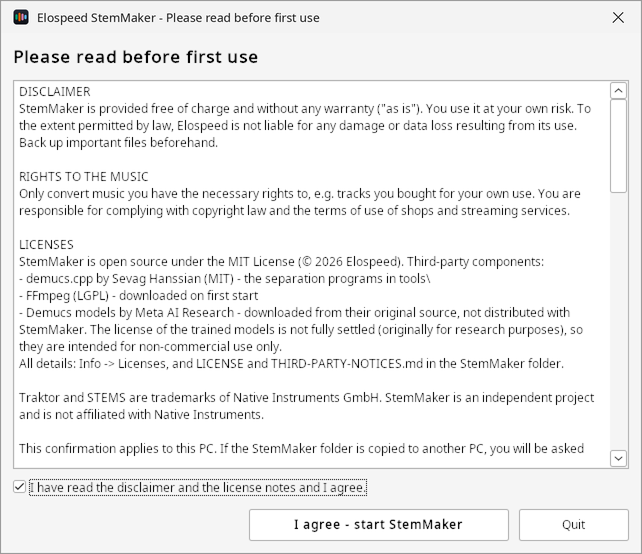
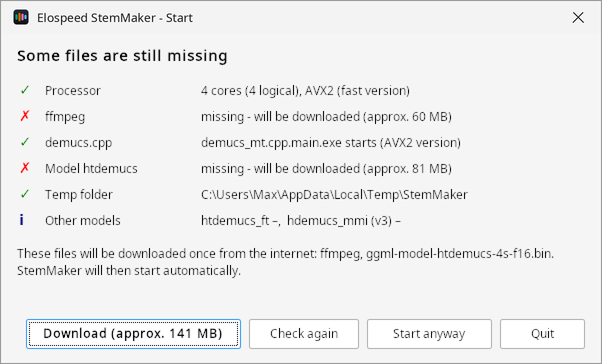
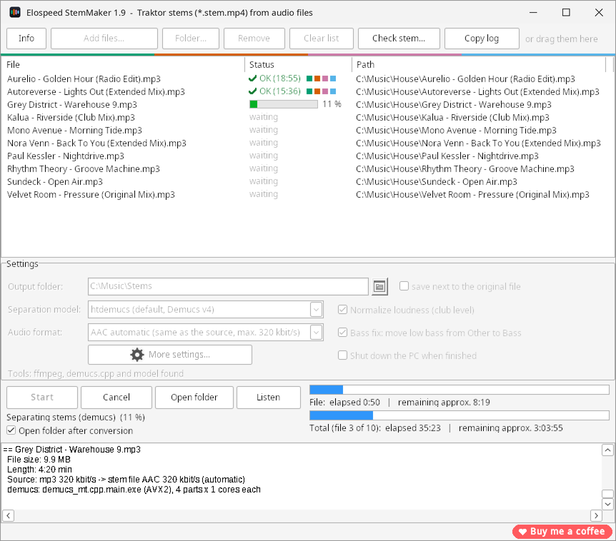
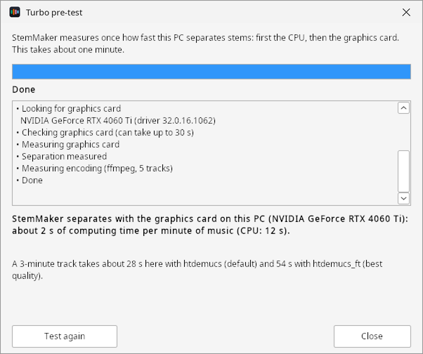
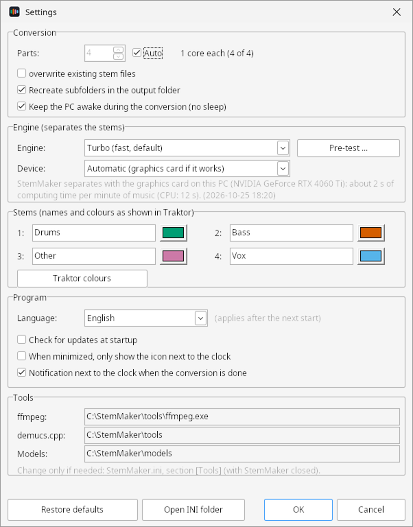
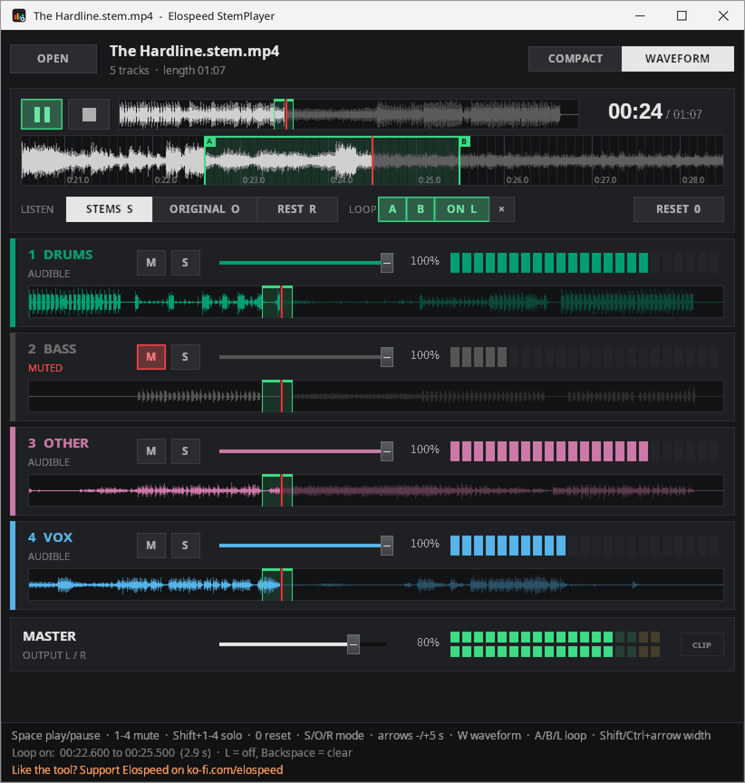
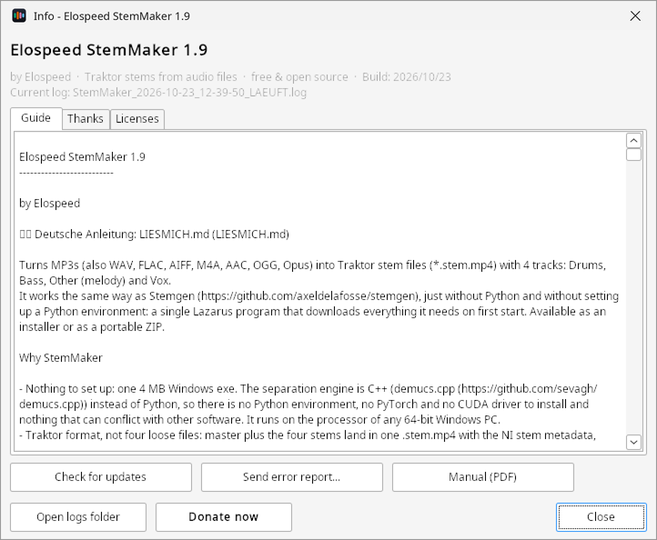

# What StemMaker does {#einleitung}

## Stems in two sentences

A **stem** is a track that holds only one part of a song, for example just the drums or just the vocals. A **stem file** (`.stem.mp4`) packs the finished song and four such tracks into a single file, so that while DJing you can turn down, mute or add effects to each part separately.

StemMaker turns your normal audio files (MP3, WAV, FLAC, AIFF, M4A, AAC, OGG, Opus) into such stem files with four parts:

::: stems
[Drums [drums, percussion]{.klein}]{.drums}
[Bass [bass, sub bass]{.klein}]{.bass}
[Other [melody, synths, the rest]{.klein}]{.other}
[Vox [vocals]{.klein}]{.vox}
:::

Traktor Pro 4 and Mixxx 2.6 play them directly in a stem deck.

## How it works {#funktionsweise}

StemMaker is a Windows program that does every step for you. You drag files into the window and click **Start**; the program does the rest:

::: ablauf
:::: schritt
**1. Unpack**

ffmpeg turns the song into an uncompressed WAV file.
::::
:::: schritt
**2. Separate**

An AI model (Demucs) listens to the song and splits it into drums, bass, other and vocals, with Turbo on the CPU or graphics card.
::::
:::: schritt
**3. Polish**

Club level raises quiet songs, the bass fix moves sub bass from Other into the bass stem.
::::
:::: schritt
**4. Pack**

Master and four stems go into one `.stem.mp4` with tags, cover art and stem info.
::::
:::

The separation runs **on your PC**: with the Turbo engine on the processor (CPU) or, if it works, on the graphics card (chapter [§](#turbo)). Your music never leaves your computer: no account, no cloud, nothing running in the background. StemMaker only goes online on the first start (to download ffmpeg and the separation model) and to check for updates.

::: info
**Good to know:** A normal music player plays a stem file like any MP4 and only plays the finished song (track 1). You hear the individual stems in your DJ software or in the included **StemPlayer** (chapter [§](#stemplayer)).
:::

## What you need

- Windows 10 or 11, 64-bit
- at least 8 GB of RAM, 16 GB or more is better
- about 320 MB for the program, the Turbo engine, ffmpeg and the model, plus room for the stem files (about three times the size of a 320 kbit/s MP3)
- an internet connection on the first start
- music you have the rights to, for example tracks you bought yourself

## How long it takes

Separating is hard work for the computer. Since version 2.0 the **Turbo engine** separates about **5 to 8 times faster** than before, depending on the PC, with the same quality. With a graphics card that works, a song is done in **under a minute**. StemMaker measures how fast your PC is in the pre-test on the first start (section [§](#vortest)).

| Computer (4-min song, default model) | Turbo (from 2.0) | Classic (up to 1.9) |
|---|---|---|
| NVIDIA RTX 4060 Ti (graphics card) | approx. 35 s | – |
| Laptop with Intel Iris Xe (graphics card) | approx. 2–3 min | – |
| Intel i5-2500 from 2011 (CPU only) | approx. 4–6 min | approx. 27 min |

The best model (htdemucs_ft) takes about three times as long as the default model. For large batches it is still worth letting the list run overnight (section [§](#sammlung)). Laptops on battery are slowed down; StemMaker then shows a note.

# Installation and first start {#installieren}

## Setup or ZIP

The project page <https://elospeed.github.io/StemMaker/> and the GitHub release page offer two downloads with the same program:

- **`StemMaker-2.0-Setup.exe`** (installer): installs StemMaker for your Windows user only, without administrator rights, with a Start menu entry. Uninstall it as usual under *Settings → Apps*.
- **`StemMaker-2.0.zip`** (portable): unzip it anywhere, for example to `C:\Tools\StemMaker` or a USB stick. Nothing is installed.

Either way you start `StemMaker.exe` (after the installer, via the Start menu entry "StemMaker").

## Windows warning on first start {#smartscreen}

StemMaker is not digitally signed, because signing certificates cost money every year. So on the first start Windows shows a blue window **"Windows protected your PC"** with publisher "Unknown". This is normal for many small open source programs.

1. Click **More info** in the blue window.
2. Click **Run anyway**.

Windows remembers this; the warning appears only once per program.

::: tipp
**Tip for the ZIP version:** Before unzipping, right-click the ZIP file → **Properties** → tick **Unblock** at the bottom → OK. Then Windows usually doesn't warn at all.
:::

## Choose the language and accept the license

On the very first start StemMaker asks for the language: **Deutsch**, **English** or **Español**. Your Windows language is already selected. You can change it later under **More settings**.

{.klein}

Next you see the disclaimer and the license notes. Read them, tick the box at the bottom and click **I agree - start StemMaker**. This happens once per PC. You can read the text again at any time under **Info → Licenses**.



## Check window and first download {#pruefen}

On every start StemMaker quickly checks that everything is in place: processor, ffmpeg, the separation programs, the separation model and the temp folder. If everything is green, the main window opens after about a second.

On the **very first start**, ffmpeg (approx. 60 MB) and the separation model (approx. 81 MB) are still missing. Clicking **Download** fetches both with a progress bar. Every file is verified with a checksum; a damaged file is rejected. StemMaker then starts by itself and measures once in the **Turbo pre-test** how fast your PC separates (section [§](#vortest)).



::: info
**Something stays red?** Hover the mouse over the red line to see the exact reason. If a file in the `tools` folder is missing, please unzip the ZIP file again completely. If the download fails, check your internet connection, firewall or proxy (chapter [§](#probleme)).
:::

# The main window {#hauptfenster}

## Overview

At the top is the list of files, below it the settings for the next conversion, and at the bottom the progress and the log.

{marken="1:1.4,5.3 2:10.2,5.3 3:36.5,5.3 4:58.6,5.3 5:49.9,39.6 6:11,48.7 7:14.5,63.9 8:1.4,71.6 9:50.6,71.2 10:49.9,87.7 11:81.8,98.3"}

::: marken
1. **Info**: version, guide, manual, updates, error report and logs (chapter [§](#info)).
2. **Add files…** and **Folder…**: add single songs or whole folders (including subfolders) to the list. Even easier: drag files and folders from Explorer straight into the window.
3. **Remove** and **Clear list**: delete selected entries or the whole list. The music files themselves are not touched.
4. **Check stem…** and **Copy log**: check a finished stem file (section [§](#stem-pruefen)) and copy the log to the clipboard.
5. **The file list** with name, status and path of every file. Double-clicking a finished file opens it in the StemPlayer.
6. **Settings** for the next conversion: output folder, separation model, audio format and the switches for club level, bass fix and shutdown (chapter [§](#einstellungen)).
7. **More settings…** (gear): everything you set up once.
8. **Start**, **Cancel**, **Open folder** and **Listen**: start or stop the conversion, open the folder with the finished files or start the StemPlayer.
9. **Two progress bars**: the current file on top, the whole list below, each with elapsed and estimated remaining time.
10. **Log**: what StemMaker is doing right now. If something goes wrong, the reason is shown here.
11. **Buy me a coffee**: opens Elospeed's Ko-fi page. Entirely voluntary; StemMaker stays free.
:::

## The file list {#dateiliste}

The **Status** column shows how far each file has got:

| Status | Meaning |
|---|---|
| waiting | will be converted on the next **Start** |
| bar with 45 % | is being converted right now |
| OK (6:12) | done, the conversion time in brackets; the four coloured dots stand for the four stems |
| already exists | a stem file with this name already exists, the file was skipped |
| cancelled | the conversion was stopped with **Cancel** |
| waiting (interrupted) | StemMaker was closed in the middle of this file; it will be done again |
| Error | did not work, the reason is in the log |

The list is saved continuously. If you close StemMaker or the power fails, it is back on the next start, and **Start** continues where it stopped.

::: tipp
**Tip:** Rather let one long list run overnight than convert single songs in between. Even before you start, the line under the lower bar shows roughly how long the whole list will take.
:::

# Converting files {#umwandeln}

## Step by step

1. **Add files to the list:** drag songs or folders from Explorer into the window, or click **Add files…** or **Folder…**. You can also drop files directly onto `StemMaker.exe`.
2. **Choose the output folder:** by default every stem file is saved next to its song. If you want all stems in one place, untick **save next to the original file** and pick an output folder with the folder button.
3. **Check the settings:** the defaults are fine to begin with (model htdemucs, AAC automatic, club level and bass fix on).
4. **Click Start.** StemMaker works through the list from top to bottom. The bars show how long it will take.
5. **Done:** if **Open folder after conversion** is ticked, Explorer opens with the finished file. From there you drag it straight into Traktor.

**Cancel** stops immediately. The file in progress is discarded and the temp files are cleaned up; finished files stay.

## Where the stem file goes

`Title.mp3` becomes `Title.stem.mp4`:

- **next to the original file** (default): in the same folder as the song.
- **in the output folder**: all stem files in one folder. If you add a whole folder and "Recreate subfolders in the output folder" is on under **More settings**, the folder structure is kept: `D:\Music\House\2024\track.mp3` becomes `<output folder>\House\2024\track.stem.mp4`.

If the stem file already exists, the song is skipped. To make it again, switch on "overwrite existing stem files" under **More settings**.

## What is carried over

StemMaker copies the tags and the **cover art** from the source file: title, artist, album, album artist, composer, genre, year, track and disc number, comment, grouping and lyrics, plus **BPM**, **key**, **label** and **ISRC**. Traktor shows title, artist, album, genre, label and cover right after import; Traktor works out BPM and key itself when it analyses the track.

## A whole collection overnight {#sammlung}

- **Time estimate before you start:** under the lower bar you see for example "87 files pending, 6:12:40 of music - approx. 11:30:00". "(rough estimate)" means StemMaker doesn't know your PC's speed yet; after the first finished song it says "(this PC's speed)", and the estimate gets more accurate with every song.
- **The list is remembered:** a crash, a power cut or closing the program costs at most the song in progress. On the next start the list is back and **Start** carries on.
- **Shut down the PC when finished:** when all files are done, a 60-second countdown with **Cancel** appears, then Windows shuts down. The tick applies only to the next run. If the conversion was cancelled, the PC does not shut down.
- **Keep the PC awake** (under **More settings**, on by default): Windows does not go to sleep during the conversion; the screen may turn off.

## Icon next to the clock

During a conversion StemMaker shows an icon in the notification area of the taskbar. Hover over it to see the progress, for example "StemMaker - 45 % (file 3 of 12)"; a click brings the window to the front. When everything is done and StemMaker is not in the foreground, a notification shows how many files succeeded, were skipped or failed.

# Turbo: faster separation {#turbo}

## What Turbo is

Since version 2.0 StemMaker separates the stems with the **Turbo engine** (StemOnnx). It runs the same Demucs model as before, so the stems are just as good, but it uses **ONNX Runtime** by Microsoft. That is much faster on the processor than the previous engine demucs.cpp and can also use the **graphics card** (NVIDIA, AMD or Intel, via DirectML, nothing extra to install).

Turbo is the default, you don't have to do anything. The previous engine stays on board as **Classic**: StemMaker uses it by itself when Turbo does not work for a file, and for the v3 model, which Turbo can't run.

## The pre-test {#vortest}

On the first start with Turbo, StemMaker measures once how fast your PC separates stems: first the CPU, then the graphics card. This takes about a minute. The pre-test comes back by itself when you put in a different graphics card or the graphics driver is new, and you can start it any time under **More settings → Pre-test ...**.



- The **bar** and the keywords show what is being tested right now.
- At the end the **bold line** says what StemMaker computes on with this PC, and how many seconds of computing one minute of music needs.
- Below it you see roughly how long a **3-minute track** takes, with the default model and with the best model. The number is there during the test already and gets more precise with every measurement.

The result goes straight into the time estimate in the main window. After the first real song, StemMaker uses the measured speed anyway.

## Graphics card (beta)

The graphics card is only used if it delivers **the same stems** as the CPU in the pre-test and is **faster**. Otherwise StemMaker separates on the CPU, and the pre-test says why, for example "is not faster than the CPU" or "crashed during the test". Older or weak graphics cards (for example without DirectX 12) are skipped this way by themselves.

If the graphics card drops out in the middle of a song, StemMaker finishes that song on the CPU. For every file the log says whether Turbo computed on the graphics card or the CPU, or Classic.

::: info
**Beta means:** With NVIDIA RTX and Intel Iris Xe it works on the tested PCs. An AMD Vega 8 and a GeForce GT 1030 were excluded by StemMaker in the test, which then correctly used the CPU. Not every combination of graphics card and driver has been tried. If the graphics card causes trouble, set the device to **CPU only** under **More settings**.
:::

## Setting engine and device

Under **More settings** in the **Engine** area (section [§](#weitere-einstellungen)):

| Setting | Choice |
|---|---|
| Engine | **Turbo (fast, default)** or **Classic (demucs.cpp, as up to 1.9)** |
| Device | **Automatic (graphics card if it works)** or **CPU only** |
| Pre-test ... | measures CPU and graphics card again |

You normally don't need Classic. It is meant for the case that Turbo does not run on a PC at all.

# Settings {#einstellungen}

## In the main window

The main window only holds what you change per conversion:

| Setting | Meaning |
|---|---|
| Output folder | where the stem files go, or with the tick **save next to the original file** |
| Separation model | quality versus speed, see section [§](#modelle) |
| Audio format | **AAC automatic** (default): the stem file gets the bitrate of the source, e.g. MP3 320 → AAC 320; sources below 192 kbit/s get 192, lossless sources 320. **AAC 256** is the NI standard, **AAC 320** fixed, **ALAC** lossless and very large (only useful for WAV/FLAC). |
| Normalize loudness (club level) | On by default. Quiet files are raised until the loudest peak sits at about −1 dB. All five tracks get the same gain, no limiter, the dynamics stay. In Traktor the waveforms are then large and easy to read. |
| Bass fix | On by default. StemMaker moves the sub bass below 80 Hz that the separation leaves in the "Other" stem into the bass stem. The bass stem sounds fuller, all stems together stay the same. Skipped for files over 20 minutes (DJ mixes). |
| Shut down the PC when finished | only for the next run, see section [§](#sammlung) |
| Open folder after conversion | opens Explorer with the finished file |

## More settings (gear) {#weitere-einstellungen}

Everything you set up once is behind the gear button **More settings…**.

{marken="1:2.3,9.9 2:2.3,15.4 3:2.3,27.9 4:51.5,40.4 5:15,56.2 6:16.6,75.3 7:2.3,96.6"}

::: marken
1. **Parts / Auto**: how many parts of the song are separated at the same time. **Auto** (default) uses as many parts as the processor has real cores (at most 4), and only as many as the RAM can handle (a good 2 GB per part). Next to it you see how the cores are shared out. This only applies to Classic; Turbo spreads the work over all cores by itself.
2. **Overwrite, subfolders, keep awake**: redo existing stem files, recreate the folder structure in the output folder, prevent sleep during the conversion.
3. **Engine**: Turbo or Classic, the device (Automatic or CPU only) and **Pre-test ...**; below it the result of the last pre-test (chapter [§](#turbo)).
4. **Stems**: name and colour of the four stems as Traktor shows them. **Traktor colours** uses the colours from Traktor's own stem files. Traktor always shows the icons (drum, speaker, wave, microphone) by slot 1 to 4.
5. **Program**: language (applies from the next start), update check at startup, icon next to the clock when minimized, and a notification when the conversion is done.
6. **Tools**: where ffmpeg, the separation programs and the models are (display only; change them in `StemMaker.ini`, see appendix).
7. **Restore defaults** resets all values in this window; **Open INI folder** shows where `StemMaker.ini` is.
:::

## Which separation model? {#modelle}

| Model | Quality | Speed | When to use |
|---|---|---|---|
| htdemucs (default) | very good | fast (with Turbo) | almost always |
| htdemucs_ft | best | approx. 3× slower than htdemucs | single important tracks, especially clean vocals |
| hdemucs_mmi (v3) | good | Classic only | only if Turbo does not run on your PC |

v3 can't run on Turbo and always computes with Classic. With Turbo the default model is therefore faster than v3, and better.

If you choose a model that is not installed yet, StemMaker asks whether to download it now.

# Stem files in DJ software {#dj-programme}

## Traktor Pro 4

Drag finished `.stem.mp4` files from Explorer into the Traktor collection or straight onto a deck. A deck set to **Stem Deck** shows the four parts with names and colours. Each part can be muted, turned down and given a filter or effect on its own.

::: tipp
**Tip:** **Open folder** in the main window takes you straight to the folder with the finished files.
:::

## Mixxx 2.6

Mixxx reads stem files from version 2.6 (currently beta). StemMaker's stem files work there without changes, with the same default colours. Mixxx always plays the sum of the four stems, not the master track.

Other programs such as rekordbox, Serato or VirtualDJ currently don't read the Traktor stem format as stems; at most they play the master track.

## Check stem {#stem-pruefen}

With **Check stem…** in the main window you pick a `.stem.mp4`. The log then shows how many audio tracks the file has (a stem file has 5) and whether the stem metadata block with names and colours is present. This also works with stems bought in the Native Instruments format.

# StemPlayer: listen before you play {#stemplayer}

The **StemPlayer** (`AddOns\StemPlayer.exe`) plays a finished stem file without any DJ software. You can mute each stem, solo it and turn it down, compare with the original and repeat a section in a loop. That way you quickly hear whether the separation worked well.

## Opening a file

- Click **Listen** in the main window: the open dialog starts in the folder of the last converted file.
- Or double-click a finished file in the file list.
- Or click **OPEN** in the StemPlayer (Ctrl+O) or drag a `.stem.mp4` onto the window.

The StemPlayer speaks the same language as StemMaker. It needs `tools\ffmpeg.exe` from the StemMaker folder.

## Overview

{.gross marken="1:1.5,5.4 2:2.9,12.7 3:16,12.8 4:3.2,20.3 5:1.5,26.6 6:17,32.6 7:1.6,81.3 8:1.6,93.9"}

::: marken
1. **OPEN** and file name, on the right the **view**: COMPACT (controls only) or WAVEFORM (with a waveform under each stem).
2. **Playback**: play/pause, stop (back to the start), time and length.
3. **Original waveform**: click or drag to jump there; the red line shows the current position.
4. **Magnifier**: shows a few seconds around the red line, for setting the loop precisely and for scrubbing.
5. **LISTEN**: mode STEMS, ORIGINAL or REST; next to it **LOOP** with A, B, ON and ×, on the right **RESET**.
6. **The four stems**: one row each with name, M (mute), S (solo), volume, level meter and waveform.
7. **MASTER**: overall volume and output level; **CLIP** lights up red if the sum overloads.
8. **Help line** with the most important keys, below it the status line.
:::

## Mute, solo and volume

- **M** (or key [1]{.taste} to [4]{.taste}): mute a stem. Muted stems are drawn in grey.
- **S** (or [Shift]{.taste} + [1]{.taste} to [4]{.taste}): hear only this stem. [Ctrl]{.taste} + click on S adds more stems (several solos).
- **Fader**: volume of each stem.
- **RESET** ([0]{.taste}): everything back, mute and solo off, faders at 100 %, mode STEMS.

## Compare stems, original and rest

| Mode | Key | What you hear |
|---|---|---|
| STEMS | [S]{.taste} | the four stems mixed, with mute, solo and faders |
| ORIGINAL | [O]{.taste} | the original mix from the file, for A/B comparison |
| REST | [R]{.taste} | original minus the sum of all stems: what got lost or sounds different in the separation (ideally almost silence) |

## Loop A-B and magnifier {#loop}

A loop repeats a section endlessly, for example to hear with mute and solo whether drums still bleed into the vocals.

- **With keys:** press [A]{.taste} at the start point and [B]{.taste} at the end point. From B playback jumps back to A seamlessly.
- **With the mouse:** drag with the **right** mouse button in a waveform from the start point to the end point. The loop runs right away.
- [L]{.taste} turns the loop off and on again; [Backspace]{.taste} or **×** deletes it.
- The loop area is highlighted green in all waveforms.

Use the **magnifier** to set the loop precisely:

- Drag with the right mouse button: new loop; start and end snap to the time grid (free with [Shift]{.taste}).
- Grab the A and B markers with the left mouse button and move them.
- Mouse wheel: zoom in (down to ¼ second) or out (up to 1 minute).
- With an active loop, [←]{.taste} [→]{.taste} move the whole loop, [Shift]{.taste} + arrow makes it wider, [Ctrl]{.taste} + arrow narrower.

## Scrubbing: find the spot by hand

If you drag the waveform in the **magnifier** left or right with the left mouse button, the red line stays put and the music moves underneath it, like a record under your hand: dragged fast it sounds high, slowly it sounds low, backwards it plays backwards, and if you hold the mouse still it is silent. When you let go, playback continues from there. That way you can find, say, the first beat of a bar exactly.

## Keyboard shortcuts {#tasten}

| Key | Function |
|---|---|
| [Space]{.taste} | play / pause |
| [1]{.taste} – [4]{.taste} | mute stem on/off |
| [Shift]{.taste} + [1]{.taste} – [4]{.taste} | solo (replaces another solo) |
| [Ctrl]{.taste} + [Shift]{.taste} + [1]{.taste} – [4]{.taste} | add a solo |
| [0]{.taste} | reset everything |
| [S]{.taste} / [O]{.taste} / [R]{.taste} | mode stems / original / rest |
| [←]{.taste} / [→]{.taste} | 5 seconds back / forward (with an active loop: move the loop) |
| [Home]{.taste} | to the start |
| [A]{.taste} / [B]{.taste} | set loop point A / B |
| [L]{.taste} | loop on / off |
| [Backspace]{.taste} | delete loop |
| [Shift]{.taste} / [Ctrl]{.taste} + arrow | loop wider / narrower |
| [W]{.taste} | view compact / waveform |
| [Ctrl]{.taste} + [O]{.taste} | open file |

# Info, updates and help {#info}

## The Info window

The **Info** button at the top left opens the Info window with version, build date and the name of the current log.

{marken="1:28.4,21.9 2:2.2,88.2 3:31.3,88.2 4:60.4,88.2 5:2.2,95.6"}

::: marken
1. **Guide**, **Thanks** and **Licenses**: the short guide (README), everyone who helped, and the disclaimer and license texts.
2. **Check for updates**: check right now whether there is a newer version.
3. **Send error report…**: send a log to Elospeed (section [§](#fehlerbericht)).
4. **Manual (PDF)**: opens this manual in your language in the browser, always the latest edition.
5. **Open logs folder**, **Donate now** and **Close**.
:::

## Updates

On start StemMaker checks in the background whether there is a newer version. If so, you can choose **Update now**, **Later** or **Skip this version**. The update is verified with its checksum. Settings, file list, logs, models and ffmpeg are kept. StemMaker never updates during a conversion, and if something goes wrong while copying, the old version stays.

Check by hand: **Info → Check for updates**. Turn it off under **More settings** ("Check for updates at startup").

## Logs

Every start writes a log to the `logs` folder (the last 20 are kept). The file name tells you how the session ended:

| Ending | Meaning |
|---|---|
| `_LAEUFT.log` | StemMaker is running |
| `.log` | ended normally |
| `_FEHLER.log` | ended normally, but there was an error along the way |
| `_ABSTURZ.log` | ended unexpectedly (crash, power cut) |

In addition StemMaker writes one line per converted file to `logs\statistik.csv` (date, file, length, model, conversion time, speed and more). The file opens with a double-click in Excel or LibreOffice.

## Sending an error report {#fehlerbericht}

After a crash, StemMaker asks on the next start whether you want to send an error report. You can also do it at any time via **Info → Send error report…**. Nothing is sent automatically: the window shows exactly the text that will leave your PC. Your user folder is replaced by `%USERPROFILE%`.

- **Send by e-mail:** the report is saved as a file and a ready-made e-mail to elospeed.dev@gmail.com opens. You attach the file yourself.
- **As GitHub issue (public):** opens a pre-filled issue in the browser (GitHub account needed).

# Troubleshooting {#probleme}

**Windows blocks the start completely, without "Run anyway".**
Then *Smart App Control* is switched on in Windows 11. StemMaker only starts once you switch it off under *Windows Security → App & browser control*. Only do this if you trust the source.

**The download on first start fails.**
Check your internet connection, firewall or proxy. If needed, do it by hand: download ffmpeg from <https://www.gyan.dev/ffmpeg/builds/> ("release essentials") and copy `ffmpeg.exe` to `tools\`; download the models from <https://huggingface.co/datasets/Retrobear/demucs.cpp/tree/main> and put the `.bin` files in `models\`.

**A file shows "Error".**
The log at the bottom gives the reason. Common causes: unusual characters in the path (e.g. Japanese; accented letters are fine) or a path longer than 259 characters. Move the file to a shorter, simple folder and start again.

**The conversion is very slow.**
Check under **More settings** that the engine is set to **Turbo**, and measure again with **Pre-test ...**. For every file the log says whether Turbo or Classic separated it. Plug laptops in and close other big programs. Large batches are best left to run overnight.

**The graphics card is not used.**
The pre-test says why (section [§](#vortest)): the card is not faster than the CPU, computes inaccurately or can't be switched on. A current graphics driver from the manufacturer often helps; the pre-test then comes back by itself on the next start. If it runs reliably on the CPU, that is not an error.

**The log says "Turbo did not work".**
Then StemMaker automatically separated this file with Classic, and the stem file is fine anyway. If it happens with every file, please send an error report (section [§](#fehlerbericht)).

**My music player only plays the normal song.**
That is expected: normal players only play the master track. You hear the stems in Traktor, Mixxx or the StemPlayer.

**Traktor shows a different BPM or key than my file.**
Traktor overwrites BPM and key with its own analysis. StemMaker still writes the values into the file.

**I have a question or an idea.**
Ask in the GitHub Discussions: <https://github.com/Elospeed/StemMaker/discussions>. Reading works without an account, writing needs a GitHub account. Or send an e-mail to elospeed.dev@gmail.com.

# Appendix {#anhang}

## Folder structure

```
StemMaker\
  StemMaker.exe          program
  StemMaker.ini          settings
  StemMaker_queue.txt    saved file list
  logs\                  logs and statistik.csv
  AddOns\
    StemPlayer.exe       test player for stem files
    StemCLI.exe          command line version
  tools\                 ffmpeg.exe and the separation programs (demucs.cpp)
    onnx\                Turbo engine: StemOnnx.exe, ONNX Runtime, DirectML
  models\                separation models (downloaded on first start)
  lang\                  language files
```

## Command line (StemCLI)

For batch files and the Windows Task Scheduler there is `AddOns\StemCLI.exe`. It uses the same tools and settings as StemMaker; StemMaker must have run once before.

```
AddOns\StemCLI.exe "D:\Music\New" -o "D:\Music\Stems" -m ht -t 4
AddOns\StemCLI.exe track.mp3 -f alac --overwrite
AddOns\StemCLI.exe --check "track.stem.mp4"
```

Options: `-o folder`, `-m ht|ft|v3`, `-t parts`, `-f aac|alac`, `-b auto|kbit`, `--overwrite`, `--keep`, `--no-awake`, `--no-normalize`, `--no-bassfix`. The first time, StemCLI wants the license accepted once with `--accept`.

## StemMaker.ini for advanced users

```ini
[Tools]
FFmpeg=D:\Programs\ffmpeg\bin\ffmpeg.exe   ; use an existing ffmpeg
ModelsDir=D:\Models                         ; keep the models elsewhere

[Update]
AutoCheck=0                                 ; don't check for updates at startup

[Turbo]
Engine=klassisch                            ; turbo (default) or klassisch (Classic)
Geraet=cpu                                  ; auto (default) or cpu
```

## Licenses and thanks

- StemMaker: © 2026 Elospeed, MIT License.
- demucs.cpp by Sevag Hanssian (MIT); Demucs models by Meta AI Research (downloaded from their original location, not redistributed by StemMaker); ONNX Runtime (MIT) and DirectML (Microsoft license) by Microsoft for Turbo; FFmpeg (LGPL); principle and metadata based on Stemgen by axeldelafosse (MIT).
- Traktor and STEMS are trademarks of Native Instruments. StemMaker is an independent project.
- Thanks to **David GJ** for the Spanish translation.
- StemMaker comes without any warranty. Please only convert music you have the rights to.

StemMaker is free and will stay free. If it saves you an evening of manual work, Elospeed is happy about a coffee at <https://ko-fi.com/elospeed> or a star on GitHub.
