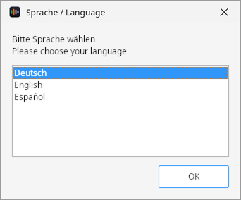
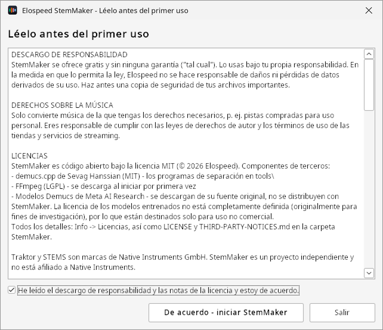
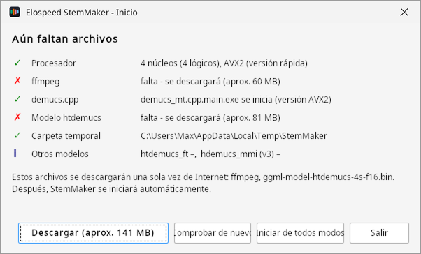
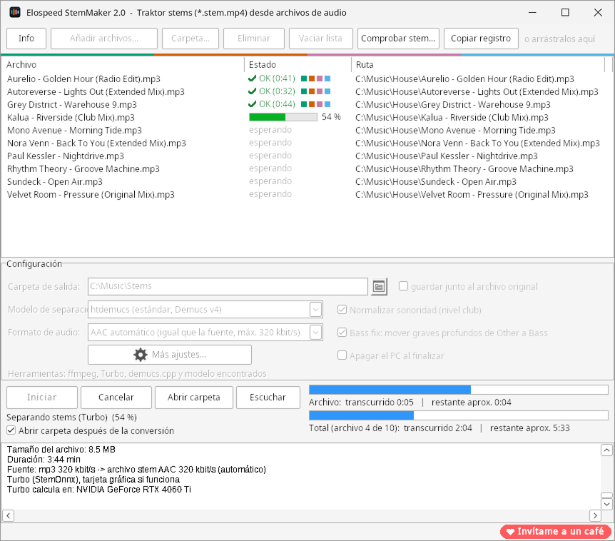
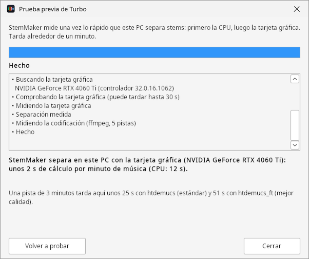
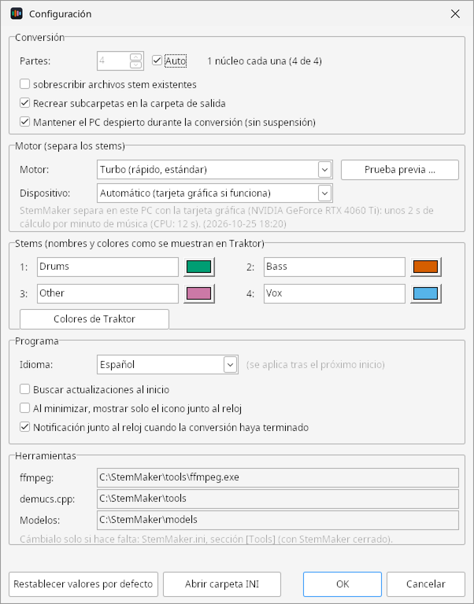
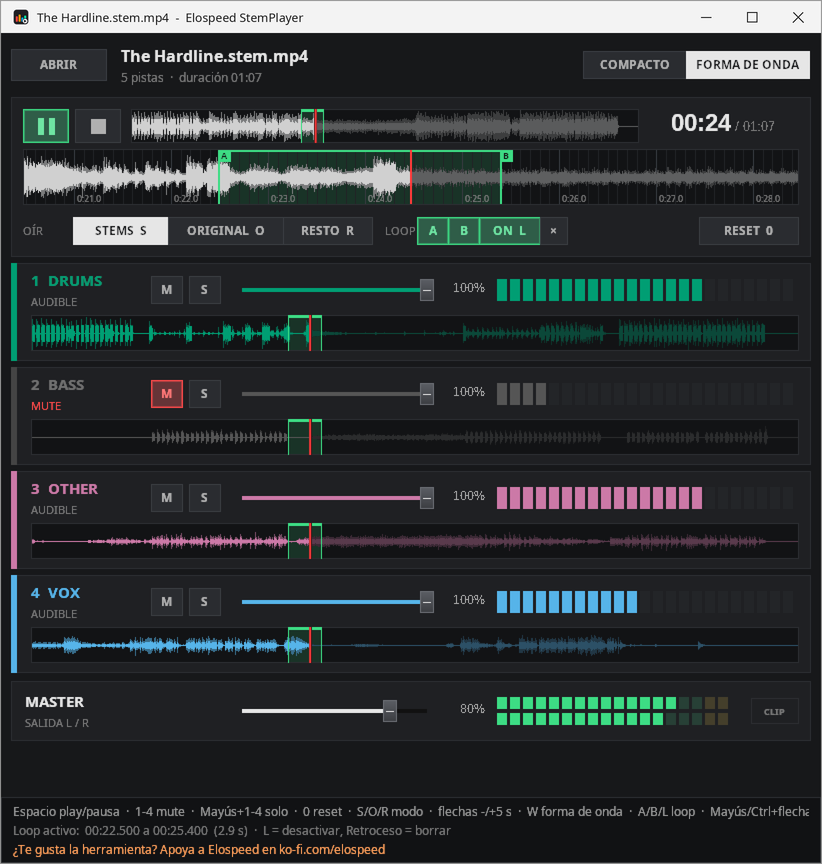
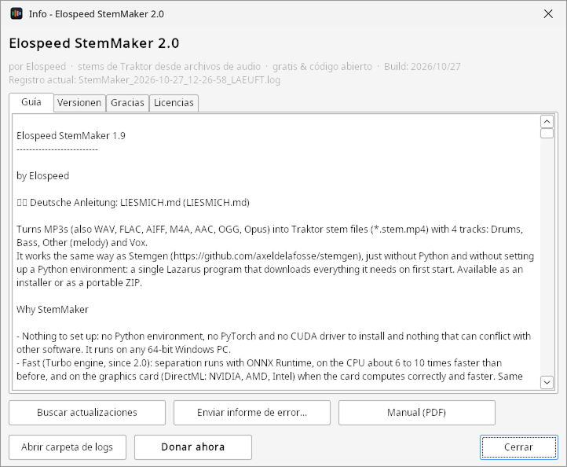

# Qué hace StemMaker {#einleitung}

## Los stems en dos frases

Un **stem** es una pista que contiene solo una parte de una canción, por ejemplo solo la batería o solo la voz. Un **archivo stem** (`.stem.mp4`) reúne la canción terminada y cuatro de esas pistas en un solo archivo, para que al pinchar puedas bajar, silenciar o poner efectos a cada parte por separado.

StemMaker convierte tus archivos de audio normales (MP3, WAV, FLAC, AIFF, M4A, AAC, OGG, Opus) en archivos stem con cuatro partes:

::: stems
[Drums [batería, percusión]{.klein}]{.drums}
[Bass [bajo, subgraves]{.klein}]{.bass}
[Other [melodía, sintes, el resto]{.klein}]{.other}
[Vox [voz]{.klein}]{.vox}
:::

Traktor Pro 4 y Mixxx 2.6 los reproducen directamente en un stem deck.

## Cómo funciona {#funktionsweise}

StemMaker es un programa para Windows que hace todos los pasos por ti. Arrastras los archivos a la ventana y haces clic en **Iniciar**; el programa hace el resto:

::: ablauf
:::: schritt
**1. Desempaquetar**

ffmpeg convierte la canción en un archivo WAV sin comprimir.
::::
:::: schritt
**2. Separar**

Un modelo de IA (Demucs) escucha la canción y la separa en batería, bajo, otros y voz, con Turbo en la CPU o la tarjeta gráfica.
::::
:::: schritt
**3. Pulir**

El nivel club sube las canciones flojas y el bass fix pasa los subgraves de Other al stem de bajo.
::::
:::: schritt
**4. Empaquetar**

El máster y los cuatro stems van a un `.stem.mp4` con etiquetas, carátula e información de stems.
::::
:::

La separación se calcula **en tu PC**: con el motor Turbo en el procesador (CPU) o, si funciona, en la tarjeta gráfica (capítulo [§](#turbo)). Tu música no sale de tu ordenador: sin cuenta, sin nube y sin nada funcionando en segundo plano. StemMaker solo se conecta a Internet en el primer inicio (para descargar ffmpeg y el modelo de separación) y para buscar actualizaciones.

::: info
**Conviene saberlo:** un reproductor de música normal trata un archivo stem como cualquier MP4 y solo reproduce la canción terminada (pista 1). Los stems por separado los oyes en tu software de DJ o en el **StemPlayer** incluido (capítulo [§](#stemplayer)).
:::

## Qué necesitas

- Windows 10 u 11 de 64 bits
- al menos 8 GB de RAM, mejor 16 GB o más
- unos 320 MB para el programa, el motor Turbo, ffmpeg y el modelo, más espacio para los archivos stem (unas tres veces el tamaño de un MP3 de 320 kbit/s)
- conexión a Internet en el primer inicio
- música sobre la que tengas los derechos, por ejemplo temas que hayas comprado

## Cuánto tarda

Separar es trabajo duro para el ordenador. Desde la versión 2.0 el **motor Turbo** separa, según el PC, unas **5 a 8 veces más rápido** que antes, con la misma calidad. Con una tarjeta gráfica que funcione, una canción está lista en **menos de un minuto**. StemMaker mide lo rápido que es tu PC en la prueba previa del primer inicio (sección [§](#vortest)).

| Ordenador (canción de 4 min, modelo estándar) | Turbo (desde 2.0) | Clásico (hasta 1.9) |
|---|---|---|
| NVIDIA RTX 4060 Ti (tarjeta gráfica) | aprox. 35 s | – |
| Portátil con Intel Iris Xe (tarjeta gráfica) | aprox. 2–3 min | – |
| Intel i5-2500 de 2011 (solo CPU) | aprox. 4–6 min | aprox. 27 min |

El mejor modelo (htdemucs_ft) tarda unas tres veces más que el estándar. Para grandes cantidades sigue valiendo la pena dejar la lista durante la noche (sección [§](#sammlung)). Los portátiles con batería van más lentos; StemMaker muestra entonces un aviso.

# Instalación y primer inicio {#installieren}

## Instalador o ZIP

En la página del proyecto <https://elospeed.github.io/StemMaker/> y en la página de versiones de GitHub hay dos descargas con el mismo programa:

- **`StemMaker-2.0-Setup.exe`** (instalador): instala StemMaker solo para tu usuario de Windows, sin derechos de administrador, con entrada en el menú Inicio. Se desinstala como siempre en *Configuración → Aplicaciones*.
- **`StemMaker-2.0.zip`** (portátil): descomprímelo donde quieras, por ejemplo en `C:\Tools\StemMaker` o en una memoria USB. No se instala nada.

En ambos casos se inicia `StemMaker.exe` (tras el instalador, desde la entrada «StemMaker» del menú Inicio).

## Aviso de Windows en el primer inicio {#smartscreen}

StemMaker no está firmado digitalmente, porque los certificados de firma cuestan dinero cada año. Por eso, en el primer inicio Windows muestra una ventana azul **«Windows protegió su PC»** con el editor «Desconocido». Es normal en muchos programas pequeños de código abierto.

1. En la ventana azul, haz clic en **Más información**.
2. Haz clic en **Ejecutar de todas formas**.

Windows lo recuerda; el aviso aparece solo una vez por programa.

::: tipp
**Consejo para la versión ZIP:** antes de descomprimir, haz clic derecho en el archivo ZIP → **Propiedades** → marca **Desbloquear** abajo → Aceptar. Así Windows normalmente no avisa.
:::

## Elegir el idioma y aceptar la licencia

En el primer inicio StemMaker pregunta el idioma: **Deutsch**, **English** o **Español**. El idioma de Windows ya viene seleccionado. Puedes cambiarlo más tarde en **Más ajustes**.

{.klein}

Después aparecen el descargo de responsabilidad y los avisos de licencia. Léelos, marca la casilla de abajo y haz clic en **De acuerdo - iniciar StemMaker**. Esto ocurre una vez por PC. Puedes volver a leer el texto en cualquier momento en **Info → Licencias**.



## Ventana de comprobación y primera descarga {#pruefen}

En cada inicio StemMaker comprueba rápidamente que todo esté en su sitio: procesador, ffmpeg, los programas de separación, el modelo de separación y la carpeta temporal. Si todo está en verde, la ventana principal se abre al cabo de un segundo.

En el **primer inicio** aún faltan ffmpeg (aprox. 60 MB) y el modelo de separación (aprox. 81 MB). Un clic en **Descargar** baja ambos con barra de progreso. Cada archivo se verifica con una suma de comprobación; un archivo dañado se descarta. Después StemMaker arranca solo y mide una vez en la **prueba previa de Turbo** lo rápido que separa tu PC (sección [§](#vortest)).



::: info
**¿Algo sigue en rojo?** Pasa el ratón por encima de la línea roja para ver el motivo exacto. Si falta un archivo en la carpeta `tools`, vuelve a descomprimir el ZIP completo. Si la descarga falla, comprueba la conexión a Internet, el cortafuegos o el proxy (capítulo [§](#probleme)).
:::

# La ventana principal {#hauptfenster}

## Vista general

Arriba está la lista de archivos, debajo los ajustes para la próxima conversión y abajo del todo el progreso y el registro.

{marken="1:1.4,5.3 2:10.2,5.3 3:36.5,5.3 4:58.6,5.3 5:49.9,39.6 6:11,48.7 7:14.5,63.9 8:1.4,71.6 9:50.6,71.2 10:49.9,87.7 11:81.8,98.3"}

::: marken
1. **Info**: versión, guía, manual, actualizaciones, informe de error y registros (capítulo [§](#info)).
2. **Añadir archivos…** y **Carpeta…**: añade canciones sueltas o carpetas enteras (con subcarpetas) a la lista. Más fácil todavía: arrastra archivos y carpetas desde el Explorador directamente a la ventana.
3. **Eliminar** y **Vaciar lista**: borra las entradas seleccionadas o la lista entera. Los archivos de música no se tocan.
4. **Comprobar stem…** y **Copiar registro**: comprueba un archivo stem terminado (sección [§](#stem-pruefen)) y copia el registro al portapapeles.
5. **La lista de archivos** con nombre, estado y ruta de cada archivo. Un doble clic en un archivo terminado lo abre en el StemPlayer.
6. **Ajustes** para la próxima conversión: carpeta de salida, modelo de separación, formato de audio y los interruptores de nivel club, bass fix y apagado (capítulo [§](#einstellungen)).
7. **Más ajustes…** (engranaje): todo lo que se configura una sola vez.
8. **Iniciar**, **Cancelar**, **Abrir carpeta** y **Escuchar**: inicia o detiene la conversión, abre la carpeta con los archivos terminados o inicia el StemPlayer.
9. **Dos barras de progreso**: arriba el archivo actual, abajo la lista entera, cada una con el tiempo transcurrido y el restante estimado.
10. **Registro**: lo que StemMaker está haciendo. Si algo falla, aquí aparece el motivo.
11. **Invítame a un café**: abre la página de Ko-fi de Elospeed. Totalmente voluntario; StemMaker sigue siendo gratuito.
:::

## La lista de archivos {#dateiliste}

La columna **Estado** muestra cómo va cada archivo:

| Estado | Significado |
|---|---|
| esperando | se convertirá en el próximo **Iniciar** |
| barra con 45 % | se está convirtiendo ahora |
| OK (6:12) | terminado, entre paréntesis el tiempo de conversión; los cuatro puntos de color representan los cuatro stems |
| ya existe | ya hay un archivo stem con ese nombre, el archivo se ha omitido |
| cancelado | la conversión se detuvo con **Cancelar** |
| esperando (interrumpido) | StemMaker se cerró en mitad de este archivo; se volverá a hacer |
| Error | no ha funcionado, el motivo está en el registro |

La lista se guarda continuamente. Si cierras StemMaker o se va la luz, la lista vuelve a estar en el próximo inicio, e **Iniciar** sigue donde se quedó.

::: tipp
**Consejo:** mejor dejar una lista larga durante la noche que convertir canciones sueltas entre medias. Ya antes de empezar, bajo la barra inferior ves cuánto tardará más o menos la lista entera.
:::

# Convertir archivos {#umwandeln}

## Paso a paso

1. **Añade archivos a la lista:** arrastra canciones o carpetas desde el Explorador a la ventana, o haz clic en **Añadir archivos…** o **Carpeta…**. También puedes soltar archivos directamente sobre `StemMaker.exe`.
2. **Elige la carpeta de salida:** por defecto cada archivo stem se guarda junto a su canción. Si quieres todos los stems en un solo sitio, desmarca **guardar junto al archivo original** y elige una carpeta de salida con el botón de carpeta.
3. **Revisa los ajustes:** para empezar, los valores por defecto están bien (modelo htdemucs, AAC automático, nivel club y bass fix activados).
4. **Haz clic en Iniciar.** StemMaker procesa la lista de arriba abajo. Las barras muestran cuánto falta.
5. **Listo:** si está marcado **Abrir carpeta después de la conversión**, se abre el Explorador con el archivo terminado. Desde ahí lo arrastras directamente a Traktor.

**Cancelar** detiene al instante. El archivo en curso se descarta y se limpian los archivos temporales; los archivos terminados se quedan.

## Dónde se guarda el archivo stem

`Titulo.mp3` se convierte en `Titulo.stem.mp4`:

- **junto al archivo original** (por defecto): en la misma carpeta que la canción.
- **en la carpeta de salida**: todos los archivos stem en una carpeta. Si añades una carpeta entera y en **Más ajustes** está activado «Recrear subcarpetas en la carpeta de salida», se mantiene la estructura: `D:\Musica\House\2024\track.mp3` pasa a `<carpeta de salida>\House\2024\track.stem.mp4`.

Si el archivo stem ya existe, la canción se omite. Para volver a hacerlo, activa «sobrescribir archivos stem existentes» en **Más ajustes**.

## Qué se conserva

StemMaker copia las etiquetas y la **carátula** del archivo de origen: título, artista, álbum, artista del álbum, compositor, género, año, número de pista y de disco, comentario, agrupación y letra, además de **BPM**, **tonalidad**, **sello** e **ISRC**. Traktor muestra título, artista, álbum, género, sello y carátula nada más importar; el BPM y la tonalidad los calcula Traktor al analizar el tema.

## Una colección entera durante la noche {#sammlung}

- **Estimación de tiempo antes de empezar:** bajo la barra inferior ves por ejemplo «87 archivos pendientes, 6:12:40 de música - aprox. 11:30:00». «(estimación aproximada)» significa que StemMaker aún no conoce la velocidad de tu PC; tras la primera canción terminada pone «(velocidad de este PC)» y la estimación mejora con cada canción.
- **La lista se recuerda:** un cuelgue, un corte de luz o cerrar el programa cuesta como mucho la canción en curso. En el próximo inicio la lista vuelve a estar e **Iniciar** continúa.
- **Apagar el PC al finalizar:** cuando todos los archivos están listos, aparece una cuenta atrás de 60 segundos con **Cancelar** y después Windows se apaga. La casilla vale solo para la próxima ejecución. Si se canceló la conversión, el PC no se apaga.
- **Mantener el PC despierto** (en **Más ajustes**, activado por defecto): Windows no entra en suspensión durante la conversión; la pantalla sí puede apagarse.

## Icono junto al reloj

Durante una conversión StemMaker muestra un icono en el área de notificación de la barra de tareas. Al pasar el ratón por encima ves el progreso, por ejemplo «StemMaker - 45 % (archivo 3 de 12)»; un clic trae la ventana al frente. Cuando todo ha terminado y StemMaker no está en primer plano, aparece una notificación con cuántos archivos han salido bien, se han omitido o han fallado.

# Turbo: separar más rápido {#turbo}

## Qué es Turbo

Desde la versión 2.0 StemMaker separa los stems con el **motor Turbo** (StemOnnx). Calcula el mismo modelo Demucs que antes, así que los stems son igual de buenos, pero usa **ONNX Runtime** de Microsoft. En el procesador es mucho más rápido que el motor anterior demucs.cpp y además puede usar la **tarjeta gráfica** (NVIDIA, AMD o Intel, mediante DirectML, sin instalar nada más).

Turbo viene activado por defecto, no tienes que hacer nada. El motor anterior sigue disponible como **Clásico**: StemMaker lo usa solo cuando Turbo no funciona con un archivo, y para el modelo v3, que Turbo no admite.

## La prueba previa {#vortest}

En el primer inicio con Turbo, StemMaker mide una vez lo rápido que tu PC separa stems: primero la CPU y después la tarjeta gráfica. Tarda alrededor de un minuto. La prueba previa vuelve sola cuando montas otra tarjeta gráfica o el controlador gráfico es nuevo, y puedes iniciarla cuando quieras en **Más ajustes → Prueba previa ...**.



- La **barra** y las palabras clave muestran qué se está probando en ese momento.
- Al final, la **línea en negrita** dice con qué calcula StemMaker en este PC y cuántos segundos de cálculo necesita un minuto de música.
- Debajo aparece cuánto tarda aproximadamente una **pista de 3 minutos**, con el modelo estándar y con el mejor modelo. La cifra ya aparece durante la prueba y se vuelve más precisa con cada medición.

El resultado pasa enseguida a la estimación de tiempo de la ventana principal. Tras la primera canción real, StemMaker calcula de todos modos con la velocidad medida.

## Tarjeta gráfica (beta)

La tarjeta gráfica solo se usa si en la prueba previa da **los mismos stems** que la CPU y es **más rápida**. Si no, StemMaker separa con la CPU y la prueba previa dice por qué, por ejemplo «no es más rápida que la CPU» o «se ha bloqueado durante la prueba». Así, las tarjetas gráficas antiguas o débiles (por ejemplo sin DirectX 12) se descartan solas.

Si la tarjeta gráfica falla en medio de una canción, StemMaker termina esa canción con la CPU. En el registro pone, para cada archivo, si Turbo calculó con la tarjeta gráfica o con la CPU, o si se usó Clásico.

::: info
**Beta significa:** con NVIDIA RTX e Intel Iris Xe funciona en los PCs probados. Una AMD Vega 8 y una GeForce GT 1030 quedaron descartadas en la prueba y StemMaker usó correctamente la CPU. No se han probado todas las combinaciones de tarjeta gráfica y controlador. Si la tarjeta gráfica da problemas, pon el dispositivo en **Solo CPU** en **Más ajustes**.
:::

## Ajustar motor y dispositivo

En **Más ajustes**, en la zona **Motor** (sección [§](#weitere-einstellungen)):

| Ajuste | Opciones |
|---|---|
| Motor | **Turbo (rápido, estándar)** o **Clásico (demucs.cpp, como hasta la 1.9)** |
| Dispositivo | **Automático (tarjeta gráfica si funciona)** o **Solo CPU** |
| Prueba previa ... | vuelve a medir la CPU y la tarjeta gráfica |

Normalmente no necesitas Clásico. Está pensado para el caso de que Turbo no funcione en un PC.

# Ajustes {#einstellungen}

## En la ventana principal

En la ventana principal solo está lo que se cambia en cada conversión:

| Ajuste | Significado |
|---|---|
| Carpeta de salida | dónde se guardan los archivos stem, o con la casilla **guardar junto al archivo original** |
| Modelo de separación | calidad frente a velocidad, ver sección [§](#modelle) |
| Formato de audio | **AAC automático** (por defecto): el archivo stem recibe la tasa de bits del origen, p. ej. MP3 320 → AAC 320; los orígenes por debajo de 192 kbit/s reciben 192, los orígenes sin pérdida 320. **AAC 256** es el estándar de NI, **AAC 320** fijo, **ALAC** sin pérdida y muy grande (solo tiene sentido con WAV/FLAC). |
| Normalizar sonoridad (nivel club) | Activado por defecto. Los archivos flojos se suben hasta que el pico más alto queda en torno a −1 dB. Las cinco pistas reciben la misma ganancia, sin limitador; la dinámica se mantiene. En Traktor las formas de onda se ven grandes y legibles. |
| Bass fix | Activado por defecto. StemMaker pasa al stem de bajo los subgraves por debajo de 80 Hz que la separación deja en el stem «Other». El bajo suena más lleno y todos los stems juntos suenan igual. Se omite en archivos de más de 20 minutos (sesiones de DJ). |
| Apagar el PC al finalizar | solo para la próxima ejecución, ver sección [§](#sammlung) |
| Abrir carpeta después de la conversión | abre el Explorador con el archivo terminado |

## Más ajustes (engranaje) {#weitere-einstellungen}

Todo lo que se configura una sola vez está detrás del botón del engranaje **Más ajustes…**.

{marken="1:2.3,9.9 2:2.3,15.4 3:2.3,27.9 4:51.5,40.4 5:15,56.2 6:16.6,75.3 7:2.3,96.6"}

::: marken
1. **Partes / Auto**: cuántas partes de la canción se separan a la vez. **Auto** (por defecto) usa tantas partes como núcleos reales tenga el procesador (como máximo 4), y solo tantas como aguante la RAM (algo más de 2 GB por parte). Al lado se ve cómo se reparten los núcleos. Esto solo vale para Clásico; Turbo reparte el trabajo él solo entre todos los núcleos.
2. **Sobrescribir, subcarpetas, mantener despierto**: rehacer archivos stem existentes, recrear la estructura de carpetas en la carpeta de salida, evitar la suspensión durante la conversión.
3. **Motor**: Turbo o Clásico, el dispositivo (Automático o Solo CPU) y **Prueba previa ...**; debajo, el resultado de la última prueba previa (capítulo [§](#turbo)).
4. **Stems**: nombre y color de los cuatro stems tal y como los muestra Traktor. **Colores de Traktor** usa los colores de los archivos stem propios de Traktor. Traktor muestra siempre los iconos (tambor, altavoz, onda, micrófono) según la posición 1 a 4.
5. **Programa**: idioma (se aplica tras el próximo inicio), búsqueda de actualizaciones al inicio, icono junto al reloj al minimizar y notificación al terminar la conversión.
6. **Herramientas**: dónde están ffmpeg, los programas de separación y los modelos (solo se muestran; se cambian en `StemMaker.ini`, ver apéndice).
7. **Restablecer valores por defecto** reinicia todos los valores de esta ventana; **Abrir carpeta INI** muestra dónde está `StemMaker.ini`.
:::

## ¿Qué modelo de separación? {#modelle}

| Modelo | Calidad | Velocidad | Cuándo usarlo |
|---|---|---|---|
| htdemucs (estándar) | muy buena | rápido (con Turbo) | casi siempre |
| htdemucs_ft | la mejor | aprox. 3× más lento que htdemucs | temas sueltos importantes, voces especialmente limpias |
| hdemucs_mmi (v3) | buena | solo Clásico | solo si Turbo no funciona en tu PC |

v3 no funciona con Turbo y siempre calcula con Clásico. Por eso, con Turbo el modelo estándar es más rápido que v3, y mejor.

Si eliges un modelo que aún no está instalado, StemMaker pregunta si quieres descargarlo ahora.

# Archivos stem en software de DJ {#dj-programme}

## Traktor Pro 4

Arrastra los archivos `.stem.mp4` terminados desde el Explorador a la colección de Traktor o directamente a un deck. Un deck configurado como **Stem Deck** muestra las cuatro partes con nombres y colores. Cada parte se puede silenciar, bajar y ponerle un filtro o efecto por separado.

::: tipp
**Consejo:** con **Abrir carpeta** en la ventana principal vas directamente a la carpeta con los archivos terminados.
:::

## Mixxx 2.6

Mixxx lee archivos stem a partir de la versión 2.6 (por ahora en beta). Los archivos stem de StemMaker funcionan ahí sin cambios, con los mismos colores por defecto. Mixxx reproduce siempre la suma de los cuatro stems, no la pista máster.

Otros programas como rekordbox, Serato o VirtualDJ no leen hoy el formato stem de Traktor como stems; como mucho reproducen la pista máster.

## Comprobar stem {#stem-pruefen}

Con **Comprobar stem…** en la ventana principal eliges un `.stem.mp4`. El registro muestra cuántas pistas de audio tiene el archivo (un archivo stem tiene 5) y si está el bloque de metadatos stem con nombres y colores. También funciona con stems comprados en el formato de Native Instruments.

# StemPlayer: escuchar antes de pinchar {#stemplayer}

El **StemPlayer** (`AddOns\StemPlayer.exe`) reproduce un archivo stem terminado sin software de DJ. Puedes silenciar cada stem, escucharlo en solo y bajarlo, compararlo con el original y repetir un fragmento en bucle. Así oyes enseguida si la separación ha salido bien.

## Abrir un archivo

- Haz clic en **Escuchar** en la ventana principal: el diálogo de abrir empieza en la carpeta del último archivo convertido.
- O haz doble clic en un archivo terminado de la lista.
- O haz clic en **ABRIR** en el StemPlayer (Ctrl+O) o arrastra un `.stem.mp4` a la ventana.

El StemPlayer habla el mismo idioma que StemMaker. Necesita `tools\ffmpeg.exe` de la carpeta de StemMaker.

## Vista general

{.gross marken="1:1.5,5.4 2:2.9,12.7 3:16,12.8 4:3.2,20.3 5:1.5,26.6 6:17,32.6 7:1.6,81.3 8:1.6,93.9"}

::: marken
1. **ABRIR** y nombre del archivo; a la derecha la **vista**: COMPACTO (solo controles) o FORMA DE ONDA (con la onda bajo cada stem).
2. **Reproducción**: reproducir/pausa, stop (vuelta al principio), tiempo y duración.
3. **Forma de onda del original**: haz clic o arrastra para saltar ahí; la línea roja indica la posición actual.
4. **Lupa**: muestra unos segundos alrededor de la línea roja, para colocar el bucle con precisión y para el scrubbing.
5. **OÍR**: modo STEMS, ORIGINAL o RESTO; al lado **LOOP** con A, B, ON y ×, a la derecha **RESET**.
6. **Los cuatro stems**: una fila para cada uno con nombre, M (mute), S (solo), volumen, medidor de nivel y forma de onda.
7. **MASTER**: volumen general y nivel de salida; **CLIP** se enciende en rojo si la suma satura.
8. **Línea de ayuda** con las teclas más importantes y debajo la línea de estado.
:::

## Silenciar, solo y volumen

- **M** (o tecla [1]{.taste} a [4]{.taste}): silencia un stem. Los stems silenciados se dibujan en gris.
- **S** (o [Mayús]{.taste} + [1]{.taste} a [4]{.taste}): escucha solo este stem. Con [Ctrl]{.taste} + clic en S añades más stems (varios solos).
- **Fader**: volumen de cada stem.
- **RESET** ([0]{.taste}): todo vuelve a su sitio, mute y solo desactivados, faders al 100 %, modo STEMS.

## Comparar stems, original y resto

| Modo | Tecla | Qué oyes |
|---|---|---|
| STEMS | [S]{.taste} | los cuatro stems mezclados, con mute, solo y faders |
| ORIGINAL | [O]{.taste} | la mezcla original del archivo, para comparar A/B |
| RESTO | [R]{.taste} | original menos la suma de todos los stems: lo que se ha perdido o suena distinto en la separación (lo ideal: casi silencio) |

## Bucle A-B y lupa {#loop}

Un bucle repite un fragmento sin fin, por ejemplo para oír con mute y solo si en la voz todavía se cuela la batería.

- **Con el teclado:** pulsa [A]{.taste} en el punto de inicio y [B]{.taste} en el punto final. Desde B la reproducción vuelve a A sin cortes.
- **Con el ratón:** arrastra con el botón **derecho** en una forma de onda desde el punto de inicio hasta el final. El bucle empieza al momento.
- [L]{.taste} desactiva y vuelve a activar el bucle; [Retroceso]{.taste} o **×** lo borra.
- La zona del bucle aparece en verde en todas las formas de onda.

En la **lupa** colocas el bucle con precisión:

- Arrastrar con el botón derecho: bucle nuevo; inicio y final se ajustan a la rejilla de tiempo (libre con [Mayús]{.taste}).
- Coge las marcas A y B con el botón izquierdo y muévelas.
- Rueda del ratón: acercar (hasta ¼ de segundo) o alejar (hasta 1 minuto).
- Con un bucle activo, [←]{.taste} [→]{.taste} mueven el bucle entero, [Mayús]{.taste} + flecha lo ensancha y [Ctrl]{.taste} + flecha lo estrecha.

## Scrubbing: buscar el punto a mano

Si arrastras la onda de la **lupa** hacia la izquierda o la derecha con el botón izquierdo, la línea roja se queda quieta y la música pasa por debajo, como un vinilo bajo la mano: arrastrado rápido suena agudo, despacio suena grave, hacia atrás suena al revés y con el ratón quieto hay silencio. Al soltar, la reproducción sigue desde ahí. Así encuentras, por ejemplo, el primer golpe de un compás con exactitud.

## Atajos de teclado {#tasten}

| Tecla | Función |
|---|---|
| [Espacio]{.taste} | reproducir / pausa |
| [1]{.taste} – [4]{.taste} | silenciar stem sí/no |
| [Mayús]{.taste} + [1]{.taste} – [4]{.taste} | solo (sustituye a otro solo) |
| [Ctrl]{.taste} + [Mayús]{.taste} + [1]{.taste} – [4]{.taste} | añadir un solo |
| [0]{.taste} | restablecer todo |
| [S]{.taste} / [O]{.taste} / [R]{.taste} | modo stems / original / resto |
| [←]{.taste} / [→]{.taste} | 5 segundos atrás / adelante (con bucle activo: mover el bucle) |
| [Inicio]{.taste} | al principio |
| [A]{.taste} / [B]{.taste} | fijar punto A / B del bucle |
| [L]{.taste} | bucle sí / no |
| [Retroceso]{.taste} | borrar bucle |
| [Mayús]{.taste} / [Ctrl]{.taste} + flecha | bucle más ancho / más estrecho |
| [W]{.taste} | vista compacta / forma de onda |
| [Ctrl]{.taste} + [O]{.taste} | abrir archivo |

# Info, actualizaciones y ayuda {#info}

## La ventana Info

El botón **Info** de arriba a la izquierda abre la ventana Info con la versión, la fecha de compilación y el nombre del registro actual.

{marken="1:38.5,21.9 2:2.2,88.2 3:31.3,88.2 4:60.4,88.2 5:2.2,95.6"}

::: marken
1. **Guía**, **Versiones**, **Gracias** y **Licencias**: la guía breve (README), qué trajo cada versión, todas las personas que han ayudado, y el descargo de responsabilidad y los textos de licencia.
2. **Buscar actualizaciones**: comprueba ahora mismo si hay una versión nueva.
3. **Enviar informe de error…**: envía un registro a Elospeed (sección [§](#fehlerbericht)).
4. **Manual (PDF)**: abre este manual en tu idioma en el navegador, siempre en su edición más reciente.
5. **Abrir carpeta de logs**, **Donar ahora** y **Cerrar**.
:::

## Actualizaciones

Al iniciarse, StemMaker comprueba en segundo plano si hay una versión nueva. Si la hay, puedes elegir **Actualizar ahora**, **Más tarde** u **Omitir esta versión**. La actualización se verifica con su suma de comprobación. Se conservan los ajustes, la lista de archivos, los registros, los modelos y ffmpeg. StemMaker nunca se actualiza durante una conversión, y si algo falla al copiar, se queda la versión anterior.

A mano: **Info → Buscar actualizaciones**. Se desactiva en **Más ajustes** («Buscar actualizaciones al inicio»).

## Registros

Cada inicio escribe un registro en la carpeta `logs` (se guardan los últimos 20). El nombre del archivo indica cómo terminó la sesión:

| Final | Significado |
|---|---|
| `_LAEUFT.log` | StemMaker está en marcha |
| `.log` | terminó con normalidad |
| `_FEHLER.log` | terminó con normalidad, pero hubo un error por el camino |
| `_ABSTURZ.log` | terminó de forma inesperada (cuelgue, corte de luz) |

Además, StemMaker escribe una línea por cada archivo convertido en `logs\statistik.csv` (fecha, archivo, duración, modelo, tiempo de conversión, velocidad y más). El archivo se abre con doble clic en Excel o LibreOffice.

## Enviar un informe de error {#fehlerbericht}

Tras un cuelgue, StemMaker pregunta en el siguiente inicio si quieres enviar un informe de error. También puedes hacerlo cuando quieras en **Info → Enviar informe de error…**. No se envía nada automáticamente: la ventana muestra exactamente el texto que saldrá de tu PC. Tu carpeta de usuario se sustituye por `%USERPROFILE%`.

- **Enviar por correo:** el informe se guarda como archivo y se abre un correo ya preparado para elospeed.dev@gmail.com. El archivo lo adjuntas tú.
- **Como issue de GitHub (público):** abre un issue ya rellenado en el navegador (hace falta una cuenta de GitHub).

# Solución de problemas {#probleme}

**Windows bloquea el inicio por completo, sin «Ejecutar de todas formas».**
Entonces está activado el *Control inteligente de aplicaciones* (Smart App Control) de Windows 11. StemMaker solo arranca si lo desactivas en *Seguridad de Windows → Control de aplicaciones y navegador*. Hazlo solo si confías en el origen.

**La descarga del primer inicio falla.**
Comprueba la conexión a Internet, el cortafuegos o el proxy. Si hace falta, a mano: descarga ffmpeg de <https://www.gyan.dev/ffmpeg/builds/> («release essentials») y copia `ffmpeg.exe` en `tools\`; descarga los modelos de <https://huggingface.co/datasets/Retrobear/demucs.cpp/tree/main> y pon los archivos `.bin` en `models\`.

**Un archivo aparece como «Error».**
El registro de abajo indica el motivo. Causas habituales: caracteres poco comunes en la ruta (p. ej. japonés; los acentos y la ñ no dan problema) o una ruta de más de 259 caracteres. Mueve el archivo a una carpeta más corta y sencilla y vuelve a empezar.

**La conversión es muy lenta.**
Comprueba en **Más ajustes** que el motor esté en **Turbo** y vuelve a medir con **Prueba previa ...**. En el registro pone, para cada archivo, si lo separó Turbo o Clásico. Enchufa los portátiles a la corriente y cierra otros programas grandes. Las grandes cantidades, mejor dejarlas durante la noche.

**No se usa la tarjeta gráfica.**
La prueba previa dice por qué (sección [§](#vortest)): la tarjeta no es más rápida que la CPU, calcula de forma imprecisa o no se puede activar. A menudo ayuda un controlador gráfico actual del fabricante; la prueba previa vuelve sola en el siguiente inicio. Si con la CPU funciona de forma fiable, no es un error.

**En el registro pone «Turbo no ha funcionado».**
Entonces StemMaker ha separado ese archivo automáticamente con Clásico y el archivo stem está bien de todos modos. Si pasa con todos los archivos, envía un informe de errores (sección [§](#fehlerbericht)).

**Mi reproductor de música solo reproduce la canción normal.**
Es lo esperado: los reproductores normales solo reproducen la pista máster. Los stems los oyes en Traktor, Mixxx o el StemPlayer.

**Traktor muestra otro BPM u otra tonalidad que mi archivo.**
Traktor sobrescribe el BPM y la tonalidad con su propio análisis. StemMaker escribe igualmente los valores en el archivo.

**Tengo una pregunta o una idea.**
Pregunta en las GitHub Discussions: <https://github.com/Elospeed/StemMaker/discussions>. Para leer no hace falta cuenta, para escribir sí una cuenta de GitHub. O escribe a elospeed.dev@gmail.com.

# Apéndice {#anhang}

## Estructura de carpetas

```
StemMaker\
  StemMaker.exe          programa
  StemMaker.ini          ajustes
  StemMaker_queue.txt    lista de archivos guardada
  logs\                  registros y statistik.csv
  AddOns\
    StemPlayer.exe       reproductor de prueba para archivos stem
    StemCLI.exe          versión de línea de comandos
  tools\                 ffmpeg.exe y los programas de separación (demucs.cpp)
    onnx\                motor Turbo: StemOnnx.exe, ONNX Runtime, DirectML
  models\                modelos de separación (se descargan en el primer inicio)
  lang\                  archivos de idioma
```

## Línea de comandos (StemCLI)

Para archivos por lotes y el Programador de tareas de Windows existe `AddOns\StemCLI.exe`. Usa las mismas herramientas y ajustes que StemMaker; StemMaker tiene que haberse ejecutado antes una vez.

```
AddOns\StemCLI.exe "D:\Musica\Nuevo" -o "D:\Musica\Stems" -m ht -t 4
AddOns\StemCLI.exe track.mp3 -f alac --overwrite
AddOns\StemCLI.exe --check "track.stem.mp4"
```

Opciones: `-o carpeta`, `-m ht|ft|v3`, `-t partes`, `-f aac|alac`, `-b auto|kbit`, `--overwrite`, `--keep`, `--no-awake`, `--no-normalize`, `--no-bassfix`. La primera vez, StemCLI pide aceptar la licencia una vez con `--accept`.

## StemMaker.ini para usuarios avanzados

```ini
[Tools]
FFmpeg=D:\Programas\ffmpeg\bin\ffmpeg.exe   ; usar un ffmpeg ya instalado
ModelsDir=D:\Modelos                         ; guardar los modelos en otro sitio

[Update]
AutoCheck=0                                  ; no buscar actualizaciones al inicio

[Turbo]
Engine=klassisch                             ; turbo (estándar) o klassisch (Clásico)
Geraet=cpu                                   ; auto (estándar) o cpu
```

## Licencias y agradecimientos

- StemMaker: © 2026 Elospeed, licencia MIT.
- demucs.cpp de Sevag Hanssian (MIT); modelos Demucs de Meta AI Research (se descargan de su ubicación original, StemMaker no los redistribuye); ONNX Runtime (MIT) y DirectML (licencia de Microsoft) de Microsoft para Turbo; FFmpeg (LGPL); principio y metadatos basados en Stemgen de axeldelafosse (MIT).
- Traktor y STEMS son marcas de Native Instruments. StemMaker es un proyecto independiente.
- Gracias a **David GJ** por la traducción al español.
- StemMaker se ofrece sin ninguna garantía. Convierte solo música sobre la que tengas los derechos.

StemMaker es gratuito y lo seguirá siendo. Si te ahorra una tarde de trabajo manual, a Elospeed le alegrará un café en <https://ko-fi.com/elospeed> o una estrella en GitHub.
